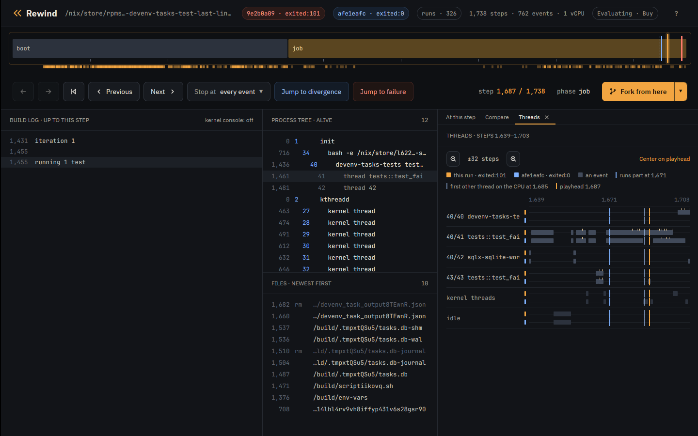

# Case study: lost task output in devenv

[devenv](https://devenv.sh/) could drop the last lines a task printed. This is
a known bug, reported in
[cachix/devenv#2281](https://github.com/cachix/devenv/issues/2281) and fixed
by the maintainer in [cachix/devenv#2296](https://github.com/cachix/devenv/pull/2296).
Rewind VM reproduced it, gdb in the VM shows `tokio::select!` taking the
child's exit with a line still buffered, and the fix passes every schedule.

Scrub the recording in your browser: [open it in the viewer](https://rewindvm.dev/viewer/?url=examples/devenv-task-output-race.rwd).

## The code

`devenv-tasks` runs each task as a child process and reads its output a line
at a time in one `tokio::select!` loop
([task_state.rs at 1.10.1](https://github.com/cachix/devenv/blob/cecb0452cacd9c524ccfc973d5caffff834cbf02/devenv-tasks/src/task_state.rs#L365-L431)):

```rust {18}
        loop {
            tokio::select! {
                result = stdout_reader.next_line(), if !stdout_closed => {
                    match result {
                        Ok(Some(line)) => {
                            ...
                            stdout_lines.push((std::time::Instant::now(), line));
                        },
                        Ok(None) => {
                            stdout_closed = true;
                        },
                        ...
                    }
                }
                result = stderr_reader.next_line(), if !stderr_closed => {
                    ...
                }
                result = child.wait() => {
                    match result {
                        Ok(status) => {
                            ...
                            if status.success() {
                                return Ok(TaskCompleted::Success(now.elapsed(), Self::get_outputs(&outputs_file).await));
                            } else {
                                return Ok(TaskCompleted::Failed(
                                    now.elapsed(),
                                    TaskFailure {
                                        stdout: stdout_lines,
                                        stderr: stderr_lines,
                                        error: format!("Task exited with status: {status}"),
                                    },
                                ));
                            }
                        },
```

When the `child.wait()` branch runs, the function returns with the lines it
has so far.

## The test

The derivation adds one test to `devenv-tasks`' unit tests and runs only that
test ([flake](../../examples/case-studies/flake.nix)):

```rust
#[tokio::test]
async fn test_failed_task_keeps_last_lines() -> Result<(), Error> {
    let temp_dir = TempDir::new().unwrap();
    let db_path = temp_dir.path().join("tasks.db");
    let script = create_script("#!/bin/sh\necho line1\necho line2\necho line3\nexit 1\n")?;
    let tasks = Tasks::builder(
        Config::try_from(json!({
            "roots": ["myapp:task_1"],
            "run_mode": "all",
            "tasks": [{ "name": "myapp:task_1", "command": script.to_str().unwrap() }]
        }))
        .unwrap(),
        VerbosityLevel::Verbose,
        Shutdown::new(),
    )
    .with_db_path(db_path)
    .build()
    .await?;
    tasks.run().await;
    match inspect_tasks(&tasks).await.as_slice() {
        [(_, TaskStatus::Completed(TaskCompleted::Failed(_, failure)))] => {
            let lines: Vec<&str> = failure.stdout.iter().map(|(_, l)| l.as_str()).collect();
            assert_eq!(lines, vec!["line1", "line2", "line3"]);
        }
        other => panic!("unexpected task statuses: {other:?}"),
    }
    Ok(())
}
```

## Run it

`tokio::select!` takes its branch order from the VM's randomness, which
`--seed` and `--epoch`, the VM's clock, set. Seed 5 fails on the first
run:

```console
$ rewind nix --epoch 1791936000 --seed 5 'github:fzakaria/rewindvm?dir=examples/case-studies#devenv-last-lines-before-2296'
rewind: packing 57 store paths for devenv-tasks-test-last-lines-before-2296
iteration 1

running 1 test
test tests::test_failed_task_keeps_last_lines ... FAILED

failures:

---- tests::test_failed_task_keeps_last_lines stdout ----
[myapp:task_1] line1
[myapp:task_1] line2

thread 'tests::test_failed_task_keeps_last_lines' (41) panicked at devenv-tasks/src/tests/mod.rs:3006:13:
assertion `left == right` failed
  left: ["line1", "line2"]
 right: ["line1", "line2", "line3"]
...
rewind: run 5947419e48b1a8dd exited:101 after 1594 steps, 0.036s virtual, 0.370s wall (poweroff)
```

```console
$ rewind replay 5947419e
identical to the recording: 763 events, 492 context switches and 145 read and write records over 1594 steps, and the whole machine at its 2 keyframes
```

The task printed three lines and devenv kept two, as in the issue.

## How often it fails

```console
$ rewind check --epoch 1791936000 --seed 5 --all --schedules 256 'github:fzakaria/rewindvm?dir=examples/case-studies#devenv-last-lines-before-2296'
schedule   0: exited:101           1594 steps    run 5947419e48b1a8dd
schedule   1: exited:101           1701 steps    run 8a1e1e249bf3127a
schedule   2: exited:101           1740 steps    run 8787649768b46bab
schedule   3: exited:101           1768 steps    run fef971a0373f1de8
...
schedule 256: exited:0             1799 steps  77ac62e2629d  run 0a847eb65c6dbb7c
schedule 0 failed; 36 of 256 other schedules ended differently

schedule 5 passes where schedule 0 fails; finding the step that decides it
schedule 5 limited to steps 835..1645 still ends differently
step 1644 decides it: a 640 µs pause of the running thread there makes the run pass

passing: run dddef5ddcdfdb922, schedule 5 over steps 835..1645
failing: run 39531d5d872fd152, schedule 5 over steps 835..1644
the two are the same run until step 1644

where /nix/store/195dbbvj5h0yq9f4vnp833dsbgxpp8w0-devenv-tasks-tests-1.10.1/bin/devenv-tasks-tests test_failed_task_keeps_last_lines first behaves differently:
  both           1500    40/42    open("/build/.tmprigw8M/tasks.db-shm", 0o2400102)
  both           1636    40/41    open("/build/devenv_task_outputdz3jv1.json", 0o2000302)
  both           1639    40/41    fork() = 43
  failing        1647    40/41    SIGCHLD code=1 addr=0x0
  failing        1656    40/41    close("anon_inode:[pidfd]")
  failing        1658    40/41    unlink("/build/devenv_task_outputdz3jv1.json")
  failing        1659    40/41    close("/build/devenv_task_outputdz3jv1.json")
  passing        1677    40/41    close("anon_inode:[pidfd]")
  passing        1679    40/41    unlink("/build/devenv_task_outputdz3jv1.json")
  passing        1680    40/41    close("/build/devenv_task_outputdz3jv1.json")
  passing        1687    40/41    unlink("/build/scriptGgRKWz.sh")

open both in the desktop app: rewind open 39531d5d872fd152 1647 --compare dddef5ddcdfdb922
```

221 of 257 runs fail, each keeping `["line1", "line2"]`. The narrowed
pair's calls part where the test learns that the task's shell has exited: in
the failing run SIGCHLD reaches it at step 1647, and in the passing
run the first call that differs is the close of the child's pidfd, at step
1677, with no SIGCHLD before it. What differs is when the task's
shell gets the CPU.

## Who had the CPU

`rewind threads` prints which thread held the CPU through each stretch of
steps, here for the failing run and then the passing one:

```console
$ rewind threads 39531d5d872fd152 --from 1628 --to 1676
      1628       1632         40/41  tests::test_fai
      1633       1633         40/42  sqlx-sqlite-wor
      1634       1639         40/41  tests::test_fai
      1640       1641     kernel 11  ksoftirqd/0
      1642       1642         43/43  tests::test_fai
      1643       1644         43/43  scriptGgRKWz.sh
      1645       1645     kernel 11  ksoftirqd/0
      1646       1672         40/41  tests::test_fai
      1673       1674     kernel 11  ksoftirqd/0
      1675       1676         40/40  devenv-tasks-te

$ rewind threads dddef5ddcdfdb922 --from 1628 --to 1676
      1628       1632         40/41  tests::test_fai
      1633       1633         40/42  sqlx-sqlite-wor
      1634       1639         40/41  tests::test_fai
      1640       1641     kernel 11  ksoftirqd/0
      1642       1642         43/43  tests::test_fai
      1643       1648         43/43  scriptGgRKWz.sh
      1649       1649     kernel 11  ksoftirqd/0
      1650       1664         40/41  tests::test_fai
      1665       1665     kernel 11  ksoftirqd/0
      1666       1672          idle  swapper/0
      1673       1673     kernel 43  scriptGgRKWz.sh
      1674       1676         40/41  tests::test_fai
```

In the failing run the shell (43) finishes exiting before thread
41 runs. In the passing run a 640 µs pause of the running thread at step 1644
holds the shell in its exit: thread 41 runs ahead, the CPU idles,
and the shell ends only at step 1673, by then a task with no memory
of its own, which `rewind threads` lists as `kernel 43`. The app's
Threads tab shows the same:



Perturbing only from step 1519, where the run forks the task's shell,
still lets some schedules pass, so the outcome is decided after the task
starts:

```console
$ rewind check --run 5947419e --schedule-from 1519 --schedules 64 --all --no-narrow
schedule   0: exited:101           1594 steps    run 5947419e48b1a8dd
schedule   1: exited:101           1626 steps    run 7d8b836c77378ac0
schedule   2: exited:101           1630 steps    run 5761b80ca8b993a3
schedule   3: exited:101           1631 steps    run 19d57727ed2513d0
...
schedule  64: exited:101           1630 steps    run fc4c3c72e947274d
run 5947419e48b1a8dd failed; 13 of 64 other schedules ended differently
```

## Where the third line went

The events of schedule 0's run around the task:

```console
$ rewind events 5947419e --from 1511 --to 1531
      1516    40/41    open("/build/devenv_task_outputasKI1s.json", 0o2000302)
      1519    40/41    fork() = 43
      1523    43/43    execve("/build/script1NPIuA.sh", ["/bin/sh", "/build/script1NPIuA.sh"])
      1524    43/43    exit_group(script1NPIuA.sh) exited:1
      1527    40/41    SIGCHLD code=1 addr=0x0
```

The shell prints all three lines and exits before the loop reads anything.
`rewind gdb` opens gdb on a fork of the run at a step. Break on `read` of the
stdout pipe (fd 13) and on the `child.wait()` branch:

```console
$ rewind gdb 5947419e 1516 -- -batch -ex 'break read if $rdi == 13' -ex 'break task_state.rs:409' -ex continue -ex 'set $buf = $rsi' -ex finish -ex 'x/s $buf' -ex 'delete 1' -ex continue
rewind: step 1516 ran in process 40; loading symbols for 5 of its files
rewind: source files for /nix/store/195dbbvj5h0yq9f4vnp833dsbgxpp8w0-devenv-tasks-tests-1.10.1 from /nix/store/hs2328bm8f7s0cq77jjjgdlcqrc13mhm-source
rewind: gdb at step 1516 of 5947419e48b1a8dd
Downloading 1.72 M separate debug info for /nix/store/h4wfwic161kxrr74jlzla5lsm28hgary-glibc-2.44-25/lib/libm.so.6...
Downloading 4.35 M separate debug info for /nix/store/h4wfwic161kxrr74jlzla5lsm28hgary-glibc-2.44-25/lib/libc.so.6...
Downloading 658.16 K separate debug info for /nix/store/h4wfwic161kxrr74jlzla5lsm28hgary-glibc-2.44-25/lib/ld-linux-x86-64.so.2...
Downloading 3.12 K source file /build/linux-7.2.8/./arch/x86/include/asm/irqflags.h...
arch_local_irq_restore (flags=514) at ./arch/x86/include/asm/irqflags.h:146
146		return !(flags & X86_EFLAGS_IF);
[Switching to thread 3 (Thread 1.41)]
Downloading 1.79 K source file /build/glibc-2.44/nptl/../sysdeps/unix/sysv/linux/x86_64/syscall_cancel.S...
#0  __syscall_cancel_arch () at ../sysdeps/unix/sysv/linux/x86_64/syscall_cancel.S:56
56		ret
Downloading 1.18 K source file /build/glibc-2.44/io/../sysdeps/unix/sysv/linux/read.c...
Breakpoint 1 at 0x7ff64601f190: file ../sysdeps/unix/sysv/linux/read.c, line 25.
Breakpoint 2 at 0x55dd6284c8a7: task_state.rs:409. (2 locations)

Thread 3 hit Breakpoint 1, __GI___libc_read (fd=13, buf=0x7ff640015f20, nbytes=8192) at ../sysdeps/unix/sysv/linux/read.c:25
25	{
0x000055dd62b239bd in std::fs::{impl#9}::read (buf=Python Exception <class 'gdb.error'>: value has been optimized out
&mut [u8](size=8192), self=<optimized out>) at /rustc/48a229ceaefd4985c50990b14116b6d856af0985/library/std/src/fs.rs:1335
⚠️ warning: 1335	/rustc/48a229ceaefd4985c50990b14116b6d856af0985/library/std/src/fs.rs: No such file or directory
Value returned is $1 = 18
0x7ff640015f20:	"line1\nline2\nline3\n"

Thread 3 hit Breakpoint 2.1, devenv_tasks::task_state::{impl#1}::run::{async_fn#0}::{async_block#0}::{async_block#0} () at devenv-tasks/src/task_state.rs:415
415	                            let expanded_paths = expand_glob_patterns(&self.task.exec_if_modified);
[Inferior 1 (process 1) detached]
```

One read returns all three lines into the `BufReader`. The loop takes two of
them, then takes the `child.wait()` branch with `line3` still buffered, and
returns.

## Root cause

Without `biased;`, `tokio::select!` polls its branches in a random order on
each pass. Once the child has exited, `child.wait()` is ready on every pass,
and so is each buffered line. Each pass is a draw between "take the next line"
and "return now", and any line still buffered when `child.wait()` wins is
lost.

The window opens when the exit is visible before the output is read. On one
CPU the shell often runs from `execve` to `exit` without giving up the CPU, so
the output and the exit are waiting together when the loop starts.

## The fix, checked

The fix
([de0dc6a8](https://github.com/cachix/devenv/commit/de0dc6a85ae88eb8194c2f7e053f3e933b77c2ac))
stores the exit status, turns the `child.wait()` branch off, and keeps
reading until both pipes are closed:

```diff
         loop {
+            // If child has exited and both pipes are closed, we're done
+            if exit_status.is_some() && stdout_closed && stderr_closed {
+                break;
+            }
+
             tokio::select! {
...
-                result = child.wait() => {
+                result = child.wait(), if exit_status.is_none() => {
...
-                            if status.success() {
-                                return Ok(TaskCompleted::Success(now.elapsed(), Self::get_outputs(&outputs_file).await));
-                            } else {
-                                ...
-                            }
+                            // Store exit status and continue draining pipes
+                            exit_status = Some(status);
```

The same test at the merge commit passes every schedule:

```console
$ rewind check --epoch 1791936000 --seed 5 --all --schedules 256 'github:fzakaria/rewindvm?dir=examples/case-studies#devenv-last-lines-2296'
rewind: packing 57 store paths for devenv-tasks-test-last-lines-2296
schedule   0: exited:0             1618 steps  77ac62e2629d  run 0e3bec4c6a2026fa
schedule   1: exited:0             1748 steps  77ac62e2629d  run 13e7c1f26410d822
schedule   2: exited:0             1769 steps  77ac62e2629d  run 69c6252f317c5320
...
0 of 256 other schedules ended differently
same result under all 257 schedules
```

On the host the unfixed test passed 1000 of 1000 runs on 16 CPUs, and 1000 of
1000 pinned to one CPU.

## The recording

Both files are in the
[case-studies release](https://github.com/fzakaria/rewindvm/releases/tag/case-studies):

- [devenv-task-output-race.rwd](https://github.com/fzakaria/rewindvm/releases/download/case-studies/devenv-task-output-race.rwd)
  (12.5 KB), the trace, for `rewind events`, `rewind log` and the app; the
  [viewer](https://rewindvm.dev/viewer/?url=examples/devenv-task-output-race.rwd) opens it in a browser.
- [devenv-task-output-race-replayable.rwd](https://github.com/fzakaria/rewindvm/releases/download/case-studies/devenv-task-output-race-replayable.rwd)
  (187.0 MB), with the kernel, input image and keyframes, for `rewind replay`,
  `rewind gdb` and `rewind shell`.

```console
$ rewind import https://github.com/fzakaria/rewindvm/releases/download/case-studies/devenv-task-output-race-replayable.rwd
$ rewind replay 5947419e
$ rewind gdb 5947419e 1516
$ rewind-app https://github.com/fzakaria/rewindvm/releases/download/case-studies/devenv-task-output-race.rwd
```
