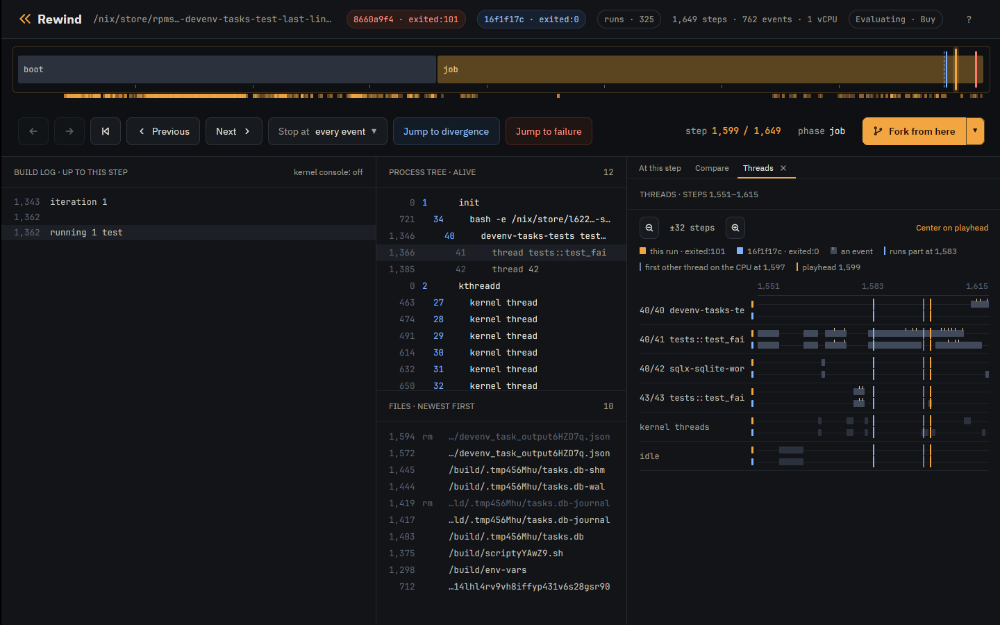

# Case study: lost task output in devenv

[devenv](https://devenv.sh/) could drop the last lines a task printed. This is
a known bug, reported in
[cachix/devenv#2281](https://github.com/cachix/devenv/issues/2281) and fixed
by the maintainer in [cachix/devenv#2296](https://github.com/cachix/devenv/pull/2296).
Rewind VM reproduced it, gdb in the VM shows `tokio::select!` taking the
child's exit with a line still buffered, and the fix passes every schedule.

Scrub the recording in your browser: [open it in the viewer](https://rewindvm.dev/viewer/?url=examples/devenv-task-output-race.rwd).

## The code

`devenv-tasks` runs each task as a child process and reads its output a line
at a time in one `tokio::select!` loop
([task_state.rs at 1.10.1](https://github.com/cachix/devenv/blob/cecb0452cacd9c524ccfc973d5caffff834cbf02/devenv-tasks/src/task_state.rs#L365-L431)):

```rust {18}
        loop {
            tokio::select! {
                result = stdout_reader.next_line(), if !stdout_closed => {
                    match result {
                        Ok(Some(line)) => {
                            ...
                            stdout_lines.push((std::time::Instant::now(), line));
                        },
                        Ok(None) => {
                            stdout_closed = true;
                        },
                        ...
                    }
                }
                result = stderr_reader.next_line(), if !stderr_closed => {
                    ...
                }
                result = child.wait() => {
                    match result {
                        Ok(status) => {
                            ...
                            if status.success() {
                                return Ok(TaskCompleted::Success(now.elapsed(), Self::get_outputs(&outputs_file).await));
                            } else {
                                return Ok(TaskCompleted::Failed(
                                    now.elapsed(),
                                    TaskFailure {
                                        stdout: stdout_lines,
                                        stderr: stderr_lines,
                                        error: format!("Task exited with status: {status}"),
                                    },
                                ));
                            }
                        },
```

When the `child.wait()` branch runs, the function returns with the lines it
has so far.

## The test

The derivation adds one test to `devenv-tasks`' unit tests and runs only that
test ([flake](../../examples/case-studies/flake.nix)):

```rust
#[tokio::test]
async fn test_failed_task_keeps_last_lines() -> Result<(), Error> {
    let temp_dir = TempDir::new().unwrap();
    let db_path = temp_dir.path().join("tasks.db");
    let script = create_script("#!/bin/sh\necho line1\necho line2\necho line3\nexit 1\n")?;
    let tasks = Tasks::builder(
        Config::try_from(json!({
            "roots": ["myapp:task_1"],
            "run_mode": "all",
            "tasks": [{ "name": "myapp:task_1", "command": script.to_str().unwrap() }]
        }))
        .unwrap(),
        VerbosityLevel::Verbose,
        Shutdown::new(),
    )
    .with_db_path(db_path)
    .build()
    .await?;
    tasks.run().await;
    match inspect_tasks(&tasks).await.as_slice() {
        [(_, TaskStatus::Completed(TaskCompleted::Failed(_, failure)))] => {
            let lines: Vec<&str> = failure.stdout.iter().map(|(_, l)| l.as_str()).collect();
            assert_eq!(lines, vec!["line1", "line2", "line3"]);
        }
        other => panic!("unexpected task statuses: {other:?}"),
    }
    Ok(())
}
```

## Run it

`tokio::select!` takes its branch order from the VM's randomness, which
`--seed` and `--epoch`, the VM's clock, set. Seed 13 fails on the first
run:

```console
$ rewind nix --epoch 1791936000 --seed 13 'github:fzakaria/rewindvm?dir=examples/case-studies#devenv-last-lines-before-2296'
rewind: packing 57 store paths for devenv-tasks-test-last-lines-before-2296
iteration 1

running 1 test
test tests::test_failed_task_keeps_last_lines ... FAILED

failures:

---- tests::test_failed_task_keeps_last_lines stdout ----
[myapp:task_1] line1
[myapp:task_1] line2

thread 'tests::test_failed_task_keeps_last_lines' (41) panicked at devenv-tasks/src/tests/mod.rs:3006:13:
assertion `left == right` failed
  left: ["line1", "line2"]
 right: ["line1", "line2", "line3"]
...
rewind: run 28affddb669acfa4 exited:101 after 1604 steps, 0.036s virtual, 0.205s wall (poweroff)
```

```console
$ rewind replay 28affddb
identical to the recording: 763 events, 491 context switches and 145 read and write records over 1604 steps, and the whole machine at its 2 keyframes
```

The task printed three lines and devenv kept two, as in the issue.

## How often it fails

```console
$ rewind check --epoch 1791936000 --seed 13 --all --schedules 256 'github:fzakaria/rewindvm?dir=examples/case-studies#devenv-last-lines-before-2296'
schedule   0: exited:101           1604 steps    run 28affddb669acfa4
schedule   1: exited:101           1747 steps    run 7f10961166e4d95d
schedule   2: exited:101           1760 steps    run 368bfdd3348949d4
schedule   3: exited:101           1768 steps    run 78c7a776e2106748
...
schedule 256: exited:0             1799 steps  77ac62e2629d  run be5095319f17d4eb
schedule 0 failed; 37 of 256 other schedules ended differently

schedule 9 passes where schedule 0 fails; finding the step that decides it
schedule 9 limited to steps 909..1593 still ends differently
step 1592 decides it: a request to switch threads there makes the run pass

passing: run 92e70d96bec6e2f4, schedule 9 over steps 909..1593
failing: run 7c84fb4d09d240f7, schedule 9 over steps 909..1592
the two are the same run until step 1592

where /nix/store/195dbbvj5h0yq9f4vnp833dsbgxpp8w0-devenv-tasks-tests-1.10.1/bin/devenv-tasks-tests test_failed_task_keeps_last_lines first behaves differently:
  both           1483    40/42    open("/build/.tmpRHRNhM/tasks.db-shm", 0o2400102)
  both           1582    40/41    open("/build/devenv_task_outputVJfKla.json", 0o2000302)
  both           1589    40/41    fork() = 43
  failing        1595    40/40    SIGCHLD code=1 addr=0x0
  failing        1606    40/41    close("anon_inode:[pidfd]")
  failing        1608    40/41    unlink("/build/devenv_task_outputVJfKla.json")
  failing        1609    40/41    close("/build/devenv_task_outputVJfKla.json")
  passing        1617    40/41    close("anon_inode:[pidfd]")
  passing        1619    40/41    unlink("/build/devenv_task_outputVJfKla.json")
  passing        1620    40/41    close("/build/devenv_task_outputVJfKla.json")
  passing        1630    40/41    unlink("/build/script5jckuV.sh")

open both in the desktop app: rewind open 7c84fb4d09d240f7 1595 --compare 92e70d96bec6e2f4
```

220 of 257 runs fail, each keeping `["line1", "line2"]`. The narrowed
pair's calls part where the test learns that the task's shell has exited: in
the failing run SIGCHLD reaches it at step 1595, and in the passing
run the first call that differs is the close of the child's pidfd, at step
1617, with no SIGCHLD before it. What differs is when the task's
shell gets the CPU.

## Who had the CPU

`rewind threads` prints which thread held the CPU through each stretch of
steps, here for the failing run and then the passing one:

```console
$ rewind threads 7c84fb4d09d240f7 --from 1576 --to 1624
      1576       1576         40/42  sqlx-sqlite-wor
      1577       1582         40/41  tests::test_fai
      1583       1583         40/42  sqlx-sqlite-wor
      1584       1586         40/41  tests::test_fai
      1587       1587     kernel 11  ksoftirqd/0
      1588       1589         40/41  tests::test_fai
      1590       1590         43/43  tests::test_fai
      1591       1592         43/43  script5jckuV.sh
      1593       1593     kernel 11  ksoftirqd/0
      1594       1595         40/40  devenv-tasks-te
      1596       1615         40/41  tests::test_fai
      1616       1616     kernel 11  ksoftirqd/0
      1617       1617         40/42  sqlx-sqlite-wor
      1618       1618         40/41  tests::test_fai
      1619       1621         40/42  sqlx-sqlite-wor
      1622       1622     kernel 11  ksoftirqd/0
      1623       1624         40/41  tests::test_fai

$ rewind threads 92e70d96bec6e2f4 --from 1576 --to 1624
      1576       1576         40/42  sqlx-sqlite-wor
      1577       1582         40/41  tests::test_fai
      1583       1583         40/42  sqlx-sqlite-wor
      1584       1586         40/41  tests::test_fai
      1587       1587     kernel 11  ksoftirqd/0
      1588       1589         40/41  tests::test_fai
      1590       1590         43/43  tests::test_fai
      1591       1592         43/43  script5jckuV.sh
      1593       1593     kernel 11  ksoftirqd/0
      1594       1609         40/41  tests::test_fai
      1610       1611     kernel 11  ksoftirqd/0
      1612       1612         43/43  script5jckuV.sh
      1613       1613     kernel 11  ksoftirqd/0
      1614       1624         40/41  tests::test_fai
```

The shell (43) starts exiting at step 1592 in both runs. In the
failing run it finishes before thread 41 runs. In the passing run
a request to switch threads at that step takes the CPU from the shell in the middle of
its exit: thread 41 runs ahead, and the shell gets the CPU back to
finish only at step 1612. The app's Threads tab shows the same:



Perturbing only from step 1529, where the run forks the task's shell,
still lets some schedules pass, so the outcome is decided after the task
starts:

```console
$ rewind check --run 28affddb --schedule-from 1529 --schedules 64 --all --no-narrow
schedule   0: exited:101           1604 steps    run 28affddb669acfa4
schedule   1: exited:101           1629 steps    run a03d644be9dbc78d
schedule   2: exited:101           1644 steps    run 203105562d216166
schedule   3: exited:101           1637 steps    run d5b91d5cf7a3f4c4
...
schedule  64: exited:101           1626 steps    run 5a08f5239c2c3ec6
run 28affddb669acfa4 failed; 7 of 64 other schedules ended differently
```

## Where the third line went

The events of schedule 0's run around the task:

```console
$ rewind events 28affddb --from 1521 --to 1541
      1526    40/41    open("/build/devenv_task_outputvu2cMW.json", 0o2000302)
      1529    40/41    fork() = 43
      1533    43/43    execve("/build/scriptTl6hDj.sh", ["/bin/sh", "/build/scriptTl6hDj.sh"])
      1534    43/43    exit_group(scriptTl6hDj.sh) exited:1
      1537    40/41    SIGCHLD code=1 addr=0x0
```

The shell prints all three lines and exits before the loop reads anything.
`rewind gdb` opens gdb on a fork of the run at a step. Break on `read` of the
stdout pipe (fd 13) and on the `child.wait()` branch:

```console
$ rewind gdb 28affddb 1526 -- -batch -ex 'break read if $rdi == 13' -ex 'break task_state.rs:409' -ex continue -ex 'set $buf = $rsi' -ex finish -ex 'x/s $buf' -ex 'delete 1' -ex continue
rewind: step 1526 ran in process 40; loading symbols for 5 of its files
rewind: source files for /nix/store/195dbbvj5h0yq9f4vnp833dsbgxpp8w0-devenv-tasks-tests-1.10.1 from /nix/store/hs2328bm8f7s0cq77jjjgdlcqrc13mhm-source
rewind: gdb at step 1526 of 28affddb669acfa4
Downloading 1.72 M separate debug info for /nix/store/h4wfwic161kxrr74jlzla5lsm28hgary-glibc-2.44-25/lib/libm.so.6...
Downloading 4.35 M separate debug info for /nix/store/h4wfwic161kxrr74jlzla5lsm28hgary-glibc-2.44-25/lib/libc.so.6...
Downloading 658.16 K separate debug info for /nix/store/h4wfwic161kxrr74jlzla5lsm28hgary-glibc-2.44-25/lib/ld-linux-x86-64.so.2...
Downloading 3.12 K source file /build/linux-7.2.8/./arch/x86/include/asm/irqflags.h...
arch_local_irq_restore (flags=514) at ./arch/x86/include/asm/irqflags.h:146
146		return !(flags & X86_EFLAGS_IF);
[Switching to thread 3 (Thread 1.41)]
Downloading 1.79 K source file /build/glibc-2.44/nptl/../sysdeps/unix/sysv/linux/x86_64/syscall_cancel.S...
#0  __syscall_cancel_arch () at ../sysdeps/unix/sysv/linux/x86_64/syscall_cancel.S:56
56		ret
Downloading 1.18 K source file /build/glibc-2.44/io/../sysdeps/unix/sysv/linux/read.c...
Breakpoint 1 at 0x7fb0924af190: file ../sysdeps/unix/sysv/linux/read.c, line 25.
Breakpoint 2 at 0x564631bd18a7: task_state.rs:409. (2 locations)

Thread 3 hit Breakpoint 1, __GI___libc_read (fd=13, buf=0x7fb08c015f20, nbytes=8192) at ../sysdeps/unix/sysv/linux/read.c:25
25	{
0x0000564631ea89bd in std::fs::{impl#9}::read (buf=Python Exception <class 'gdb.error'>: value has been optimized out
&mut [u8](size=8192), self=<optimized out>) at /rustc/48a229ceaefd4985c50990b14116b6d856af0985/library/std/src/fs.rs:1335
⚠️ warning: 1335	/rustc/48a229ceaefd4985c50990b14116b6d856af0985/library/std/src/fs.rs: No such file or directory
Value returned is $1 = 18
0x7fb08c015f20:	"line1\nline2\nline3\n"

Thread 3 hit Breakpoint 2.1, devenv_tasks::task_state::{impl#1}::run::{async_fn#0}::{async_block#0}::{async_block#0} () at devenv-tasks/src/task_state.rs:415
415	                            let expanded_paths = expand_glob_patterns(&self.task.exec_if_modified);
[Inferior 1 (process 1) detached]
```

One read returns all three lines into the `BufReader`. The loop takes two of
them, then takes the `child.wait()` branch with `line3` still buffered, and
returns.

## Root cause

Without `biased;`, `tokio::select!` polls its branches in a random order on
each pass. Once the child has exited, `child.wait()` is ready on every pass,
and so is each buffered line. Each pass is a draw between "take the next line"
and "return now", and any line still buffered when `child.wait()` wins is
lost.

The window opens when the exit is visible before the output is read. On one
CPU the shell often runs from `execve` to `exit` without giving up the CPU, so
the output and the exit are waiting together when the loop starts.

## The fix, checked

The fix
([de0dc6a8](https://github.com/cachix/devenv/commit/de0dc6a85ae88eb8194c2f7e053f3e933b77c2ac))
stores the exit status, turns the `child.wait()` branch off, and keeps
reading until both pipes are closed:

```diff
         loop {
+            // If child has exited and both pipes are closed, we're done
+            if exit_status.is_some() && stdout_closed && stderr_closed {
+                break;
+            }
+
             tokio::select! {
...
-                result = child.wait() => {
+                result = child.wait(), if exit_status.is_none() => {
...
-                            if status.success() {
-                                return Ok(TaskCompleted::Success(now.elapsed(), Self::get_outputs(&outputs_file).await));
-                            } else {
-                                ...
-                            }
+                            // Store exit status and continue draining pipes
+                            exit_status = Some(status);
```

The same test at the merge commit passes every schedule:

```console
$ rewind check --epoch 1791936000 --seed 13 --all --schedules 256 'github:fzakaria/rewindvm?dir=examples/case-studies#devenv-last-lines-2296'
rewind: packing 57 store paths for devenv-tasks-test-last-lines-2296
schedule   0: exited:0             1628 steps  77ac62e2629d  run aa74750c1166042a
schedule   1: exited:0             1766 steps  77ac62e2629d  run 0b9e8b8cabdd7b28
schedule   2: exited:0             1795 steps  77ac62e2629d  run b391c50947bbcbfa
...
0 of 256 other schedules ended differently
same result under all 257 schedules
```

On the host the unfixed test passed 1000 of 1000 runs on 16 CPUs, and 1000 of
1000 pinned to one CPU.

## The recording

Both files are in the
[case-studies release](https://github.com/fzakaria/rewindvm/releases/tag/case-studies):

- [devenv-task-output-race.rwd](https://github.com/fzakaria/rewindvm/releases/download/case-studies/devenv-task-output-race.rwd)
  (16.6 KB), the trace, for `rewind events`, `rewind log` and the app; the
  [viewer](https://rewindvm.dev/viewer/?url=examples/devenv-task-output-race.rwd) opens it in a browser.
- [devenv-task-output-race-replayable.rwd](https://github.com/fzakaria/rewindvm/releases/download/case-studies/devenv-task-output-race-replayable.rwd)
  (179.5 MB), with the kernel, input image and keyframes, for `rewind replay`,
  `rewind gdb` and `rewind shell`.

```console
$ rewind import https://github.com/fzakaria/rewindvm/releases/download/case-studies/devenv-task-output-race-replayable.rwd
$ rewind replay 28affddb
$ rewind gdb 28affddb 1526
$ rewind-app https://github.com/fzakaria/rewindvm/releases/download/case-studies/devenv-task-output-race.rwd
```
