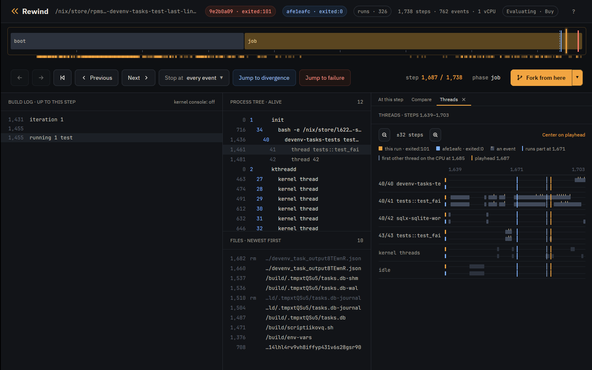

# Case study: lost task output in devenv

<!-- let epoch = 1791936000 -->
<!-- let seed = 13 -->
<!-- let flake = github:fzakaria/rewindvm?dir=examples/case-studies -->

[devenv](https://devenv.sh/) could drop the last lines a task printed. This is
a known bug, reported in
[cachix/devenv#2281](https://github.com/cachix/devenv/issues/2281) and fixed
by the maintainer in [cachix/devenv#2296](https://github.com/cachix/devenv/pull/2296).
Rewind VM reproduced it, gdb in the VM shows `tokio::select!` taking the
child's exit with a line still buffered, and the fix passes every schedule.

Scrub the recording in your browser: [open it in the viewer](https://rewindvm.dev/viewer/?url=examples/devenv-task-output-race.rwd).

## The code

`devenv-tasks` runs each task as a child process and reads its output a line
at a time in one `tokio::select!` loop
([task_state.rs at 1.10.1](https://github.com/cachix/devenv/blob/cecb0452cacd9c524ccfc973d5caffff834cbf02/devenv-tasks/src/task_state.rs#L365-L431)):

```rust {18}
        loop {
            tokio::select! {
                result = stdout_reader.next_line(), if !stdout_closed => {
                    match result {
                        Ok(Some(line)) => {
                            ...
                            stdout_lines.push((std::time::Instant::now(), line));
                        },
                        Ok(None) => {
                            stdout_closed = true;
                        },
                        ...
                    }
                }
                result = stderr_reader.next_line(), if !stderr_closed => {
                    ...
                }
                result = child.wait() => {
                    match result {
                        Ok(status) => {
                            ...
                            if status.success() {
                                return Ok(TaskCompleted::Success(now.elapsed(), Self::get_outputs(&outputs_file).await));
                            } else {
                                return Ok(TaskCompleted::Failed(
                                    now.elapsed(),
                                    TaskFailure {
                                        stdout: stdout_lines,
                                        stderr: stderr_lines,
                                        error: format!("Task exited with status: {status}"),
                                    },
                                ));
                            }
                        },
```

When the `child.wait()` branch runs, the function returns with the lines it
has so far.

## The test

The derivation adds one test to `devenv-tasks`' unit tests and runs only that
test ([flake](../../examples/case-studies/flake.nix)):

```rust
#[tokio::test]
async fn test_failed_task_keeps_last_lines() -> Result<(), Error> {
    let temp_dir = TempDir::new().unwrap();
    let db_path = temp_dir.path().join("tasks.db");
    let script = create_script("#!/bin/sh\necho line1\necho line2\necho line3\nexit 1\n")?;
    let tasks = Tasks::builder(
        Config::try_from(json!({
            "roots": ["myapp:task_1"],
            "run_mode": "all",
            "tasks": [{ "name": "myapp:task_1", "command": script.to_str().unwrap() }]
        }))
        .unwrap(),
        VerbosityLevel::Verbose,
        Shutdown::new(),
    )
    .with_db_path(db_path)
    .build()
    .await?;
    tasks.run().await;
    match inspect_tasks(&tasks).await.as_slice() {
        [(_, TaskStatus::Completed(TaskCompleted::Failed(_, failure)))] => {
            let lines: Vec<&str> = failure.stdout.iter().map(|(_, l)| l.as_str()).collect();
            assert_eq!(lines, vec!["line1", "line2", "line3"]);
        }
        other => panic!("unexpected task statuses: {other:?}"),
    }
    Ok(())
}
```

## Run it

`tokio::select!` takes its branch order from the VM's randomness, which
`--seed` and `--epoch`, the VM's clock, set. Seed {{seed}} fails on the first
run:

```console run name=first show=:16,-1:
$ rewind nix --epoch {{epoch}} --seed {{seed}} '{{flake}}#devenv-last-lines-before-2296'
```

<!-- capture run: rewind: run (\w+) exited:101 after -->
<!-- assert: sed -n 15p {{out:first}} | grep -qx '  left: \["line1", "line2"\]' && sed -n 16p {{out:first}} | grep -qx ' right: \["line1", "line2", "line3"\]' -->

```console run name=replay
$ rewind replay {{run|short}}
```

<!-- assert: grep -q '^identical to the recording: ' {{out:replay}} -->

The task printed three lines and devenv kept two, as in the issue.

## How often it fails

```console run name=check keep=^schedule\s+([0-3]|256):|^(?!schedule\s+\d+:)
$ rewind check --epoch {{epoch}} --seed {{seed}} --all --schedules 256 '{{flake}}#devenv-last-lines-before-2296'
```

<!-- assert: grep -qE '^schedule +0: exited:101 .* run {{run}}$' {{out:check}} -->
<!-- set nfails: grep -cE '^schedule +[0-9]+: exited:101 ' {{out:check}} -->
<!-- set two: for r in $(grep -E '^schedule +[0-9]+: exited:101 ' {{out:check}} | awk '{print $NF}'); do rewind log $r | grep -x '  left: \["line1", "line2"\]'; done | wc -l -->
<!-- assert: test {{two}} -eq {{nfails}} -->
<!-- assert: tr '\n' ' ' < {{dir}}/../../README.md | grep -q 'failed under {{nfails}} of 257 schedules' -->
<!-- capture passing: passing: run (\w+), -->
<!-- capture failing: failing: run (\w+), -->
<!-- capture deciding: step (\d+) decides it -->
<!-- capture deciding_words: decides it: (.+) there makes the run pass -->
<!-- capture sigchld: failing +(\d+) +\d+/\d+ +SIGCHLD -->
<!-- capture pass_close: passing +(\d+) +\d+/\d+ +close\("anon_inode:\[pidfd\]"\) -->
<!-- assert: test "$(grep -E '^  (failing|passing) ' {{out:check}} | head -1 | awk '{print $1, $2}')" = "failing {{sigchld}}" && test "$(grep -E '^  passing ' {{out:check}} | head -1 | awk '{print $2}')" = {{pass_close}} && ! grep -qE '^  passing .* SIGCHLD' {{out:check}} -->

{{nfails}} of 257 runs fail, each keeping `["line1", "line2"]`. The narrowed
pair's calls part where the test learns that the task's shell has exited: in
the failing run SIGCHLD reaches it at step {{sigchld}}, and in the passing
run the first call that differs is the close of the child's pidfd, at step
{{pass_close}}, with no SIGCHLD before it. What differs is when the task's
shell gets the CPU.

## Who had the CPU

<!-- set threads_from: echo $(( {{deciding}} - 16 )) -->
<!-- set threads_to: echo $(( {{deciding}} + 32 )) -->

`rewind threads` prints which thread held the CPU through each stretch of
steps, here for the failing run and then the passing one:

```console run name=threads
$ rewind threads {{failing}} --from {{threads_from}} --to {{threads_to}}

$ rewind threads {{passing}} --from {{threads_from}} --to {{threads_to}}
```

<!-- set shell: rewind events {{failing}} | grep -m1 'execve("/build/script' | awk '{print $2}' | cut -d/ -f1 -->
<!-- set test_tid: rewind events {{failing}} | grep -m1 'open("/build/devenv_task_output' | awk '{print $2}' | cut -d/ -f2 -->
<!-- run: rewind threads {{failing}} --from {{threads_from}} --to {{threads_to}} > threads-failing.txt -->
<!-- run: rewind threads {{passing}} --from {{threads_from}} --to {{threads_to}} > threads-passing.txt -->
<!-- set shell_start: awk '$3 == "{{shell}}/{{shell}}" && $4 ~ /^script/ {print $1}' threads-failing.txt | sed -n 1p -->
<!-- set shell_back: awk '$3 == "{{shell}}/{{shell}}" && $4 ~ /^script/ {print $1}' threads-passing.txt | sed -n 2p -->
<!-- assert: test $(awk '$3 == "{{shell}}/{{shell}}" && $4 ~ /^script/' threads-failing.txt | wc -l) -eq 1 && test $(awk '$3 == "{{shell}}/{{shell}}" && $4 ~ /^script/' threads-passing.txt | wc -l) -eq 2 -->
<!-- assert: test "$(awk '$3 == "{{shell}}/{{shell}}" && $4 ~ /^script/ {print $1, $2}' threads-failing.txt)" = "{{shell_start}} {{deciding}}" && test "$(awk '$3 == "{{shell}}/{{shell}}" && $4 ~ /^script/ {print $1, $2}' threads-passing.txt | sed -n 1p)" = "{{shell_start}} {{deciding}}" -->
<!-- assert: rewind events {{failing}} --from {{deciding}} --to {{deciding}} | grep -qE ' {{shell}}/{{shell}} +exit_group\(script' && rewind events {{passing}} --from {{deciding}} --to {{deciding}} | grep -qE ' {{shell}}/{{shell}} +exit_group\(script' -->

The shell ({{shell}}) starts exiting at step {{deciding}} in both runs. In the
failing run it finishes before thread {{test_tid}} runs. In the passing run
{{deciding_words}} at that step takes the CPU from the shell in the middle of
its exit: thread {{test_tid}} runs ahead, and the shell gets the CPU back to
finish only at step {{shell_back}}. The app's Threads tab shows the same:

<!-- screenshot site/img/devenv-threads: {{home}}/runs/{{failing}} --compare {{home}}/runs/{{passing}} --step {{shell_back}} ;; key t ;; wait 8 ;; click 1058 328 ;; wait 2 -->



<!-- set fork: rewind events {{run}} | grep -B1 -m1 'execve("/build/script' | grep -E 'fork\(\) = ' | awk '{print $1}' -->

Perturbing only from step {{fork}}, where the run forks the task's shell,
still lets some schedules pass, so the outcome is decided after the task
starts:

```console run name=fork keep=^schedule\s+([0-3]|64):|^run\s
$ rewind check --run {{run|short}} --schedule-from {{fork}} --schedules 64 --all --no-narrow
```

<!-- capture fork_pass: failed; (\d+) of 64 other schedules ended differently -->
<!-- assert: test {{fork_pass}} -gt 0 -->

## Where the third line went

<!-- set open: rewind events {{run}} | grep -m1 'open("/build/devenv_task_output' | awk '{print $1}' -->
<!-- set run_sigchld: rewind events {{run}} --from {{open}} | grep -m1 SIGCHLD | awk '{print $1}' -->
<!-- set events_from: echo $(( {{open}} - 5 )) -->
<!-- set events_to: echo $(( {{run_sigchld}} + 4 )) -->

The events of schedule 0's run around the task:

```console run name=events
$ rewind events {{run|short}} --from {{events_from}} --to {{events_to}}
```

<!-- assert: test "$(tail -3 {{out:events}} | awk '{print $3}' | cut -c1-6 | tr '\n' ' ')" = 'execve exit_g SIGCHL ' -->

The shell prints all three lines and exits before the loop reads anything.
`rewind gdb` opens gdb on a fork of the run at a step. Break on `read` of the
stdout pipe (fd 13) and on the `child.wait()` branch:

```console run name=gdb
$ rewind gdb {{run|short}} {{open}} -- -batch -ex 'break read if $rdi == 13' -ex 'break task_state.rs:409' -ex continue -ex 'set $buf = $rsi' -ex finish -ex 'x/s $buf' -ex 'delete 1' -ex continue
```

<!-- assert: grep -q 'hit Breakpoint 1, __GI___libc_read (fd=13, ' {{out:gdb}} && grep -q '^Value returned is $1 = 18$' {{out:gdb}} && grep -qF ':	"line1\nline2\nline3\n"' {{out:gdb}} && grep -q 'hit Breakpoint 2.1, devenv_tasks::task_state::' {{out:gdb}} -->

One read returns all three lines into the `BufReader`. The loop takes two of
them, then takes the `child.wait()` branch with `line3` still buffered, and
returns.

<!-- screenshot site/img/devenv-sigchld: {{home}}/runs/{{failing}} --compare {{home}}/runs/{{passing}} --step {{sigchld}} -->
<!-- set sigchld_c: python3 -c 'import sys; print("{:,}".format(int(sys.argv[1])))' {{sigchld}} -->
<!-- set deciding_c: python3 -c 'import sys; print("{:,}".format(int(sys.argv[1])))' {{deciding}} -->
<!-- set failing_steps_c: python3 -c 'import json, sys; print("{:,}".format(json.load(open(sys.argv[1]))["outcome"]["step"]))' {{home}}/runs/{{failing}}/manifest.json -->
<!-- assert: test $(( {{sigchld}} - {{deciding}} )) -eq 3 -->
<!-- assert: f={{dir}}/../../tools/md2html.py; grep -qF 'The app on the failing run {{failing|short}} at step {{sigchld_c}}, compared with the passing run {{passing|short}}.' $f && grep -qF 'failing devenv run at step {{sigchld_c}}, compared with the passing run {{passing|short}}: ' $f && grep -qF 'SIGCHLD has reached thread {{test_tid}}, and the runs are the same until step {{deciding_c}}.' $f && grep -qF 'Step {{sigchld_c}} of {{failing_steps_c}}, three steps after' $f && grep -qF 'reaches thread {{test_tid}} of the test process' $f && grep -qF 'The runs are the same until step {{deciding_c}}, where only the passing run' $f -->
<!-- assert: rewind gdb {{failing}} {{sigchld}} -- -batch -ex 'break read if $rdi == 13' -ex continue -ex 'set $buf = $rsi' -ex finish -ex 'x/s $buf' 2>&1 | grep -qF ':	"line1\nline2\nline3\n"' -->

## Root cause

Without `biased;`, `tokio::select!` polls its branches in a random order on
each pass. Once the child has exited, `child.wait()` is ready on every pass,
and so is each buffered line. Each pass is a draw between "take the next line"
and "return now", and any line still buffered when `child.wait()` wins is
lost.

The window opens when the exit is visible before the output is read. On one
CPU the shell often runs from `execve` to `exit` without giving up the CPU, so
the output and the exit are waiting together when the loop starts.

## The fix, checked

The fix
([de0dc6a8](https://github.com/cachix/devenv/commit/de0dc6a85ae88eb8194c2f7e053f3e933b77c2ac))
stores the exit status, turns the `child.wait()` branch off, and keeps
reading until both pipes are closed:

```diff
         loop {
+            // If child has exited and both pipes are closed, we're done
+            if exit_status.is_some() && stdout_closed && stderr_closed {
+                break;
+            }
+
             tokio::select! {
...
-                result = child.wait() => {
+                result = child.wait(), if exit_status.is_none() => {
...
-                            if status.success() {
-                                return Ok(TaskCompleted::Success(now.elapsed(), Self::get_outputs(&outputs_file).await));
-                            } else {
-                                ...
-                            }
+                            // Store exit status and continue draining pipes
+                            exit_status = Some(status);
```

The same test at the merge commit passes every schedule:

```console run name=fixed keep=^rewind:|^schedule\s+[0-2]:|^0\sof|^same\sresult
$ rewind check --epoch {{epoch}} --seed {{seed}} --all --schedules 256 '{{flake}}#devenv-last-lines-2296'
```

<!-- assert: grep -q '^same result under all 257 schedules$' {{out:fixed}} && grep -qE '^schedule +0: exited:0 ' {{out:fixed}} -->

On the host the unfixed test passed 1000 of 1000 runs on 16 CPUs, and 1000 of
1000 pinned to one CPU.

## The recording

<!-- set trace_size: rewind export {{run}} -o {{work}}/devenv-task-output-race.rwd 2>&1 | grep -o '([^)]*)' | tr -d '()' -->
<!-- set replayable_size: rewind export {{run}} --replayable -o {{work}}/devenv-task-output-race-replayable.rwd 2>&1 | grep -o '([^)]*)' | tr -d '()' -->
<!-- run: cp {{work}}/devenv-task-output-race.rwd {{site}}/viewer/examples/devenv-task-output-race.rwd -->

Both files are in the
[case-studies release](https://github.com/fzakaria/rewindvm/releases/tag/case-studies):

- [devenv-task-output-race.rwd](https://github.com/fzakaria/rewindvm/releases/download/case-studies/devenv-task-output-race.rwd)
  ({{trace_size}}), the trace, for `rewind events`, `rewind log` and the app; the
  [viewer](https://rewindvm.dev/viewer/?url=examples/devenv-task-output-race.rwd) opens it in a browser.
- [devenv-task-output-race-replayable.rwd](https://github.com/fzakaria/rewindvm/releases/download/case-studies/devenv-task-output-race-replayable.rwd)
  ({{replayable_size}}), with the kernel, input image and keyframes, for `rewind replay`,
  `rewind gdb` and `rewind shell`.

```console
$ rewind import https://github.com/fzakaria/rewindvm/releases/download/case-studies/devenv-task-output-race-replayable.rwd
$ rewind replay {{run|short}}
$ rewind gdb {{run|short}} {{open}}
$ rewind-app https://github.com/fzakaria/rewindvm/releases/download/case-studies/devenv-task-output-race.rwd
```
