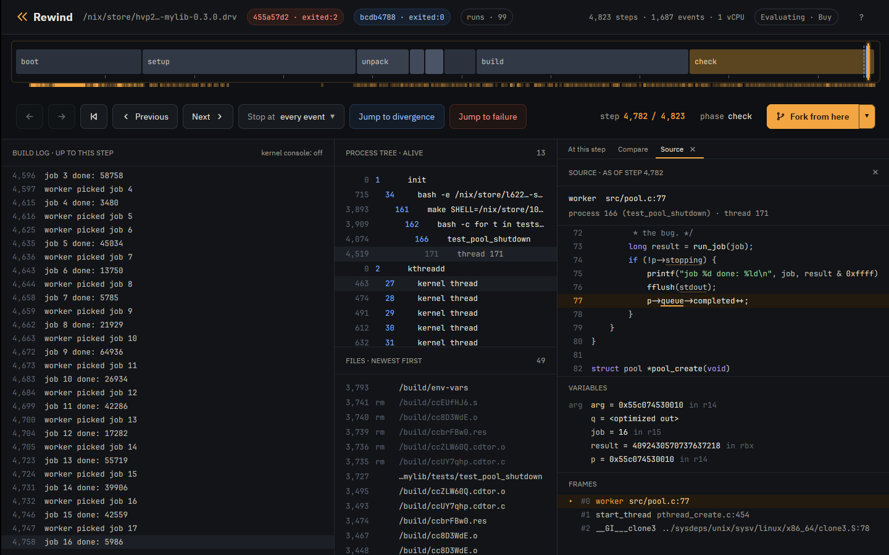
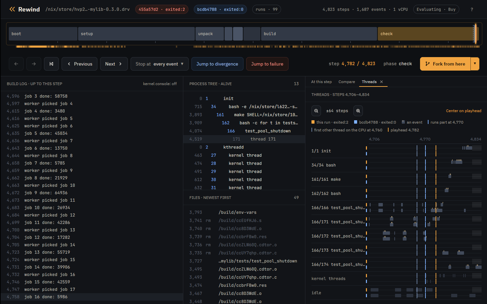
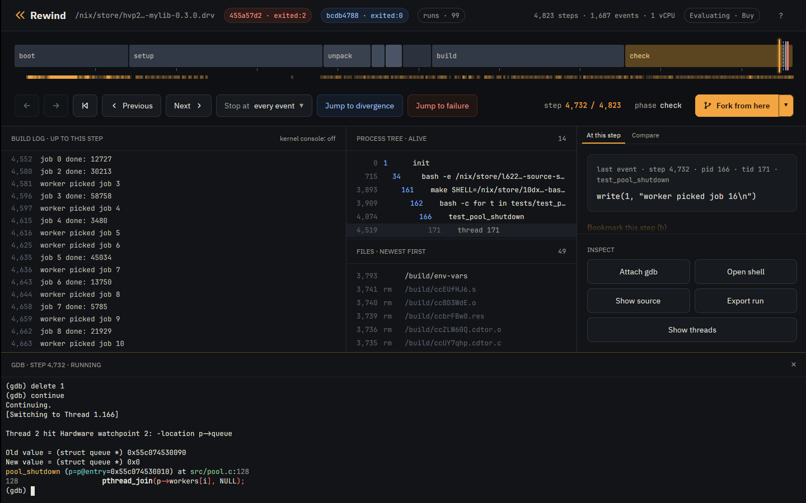
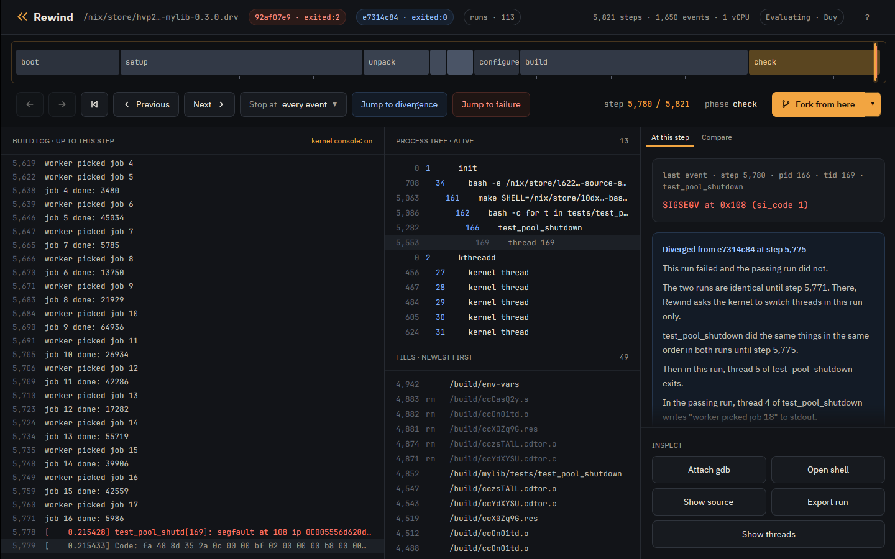
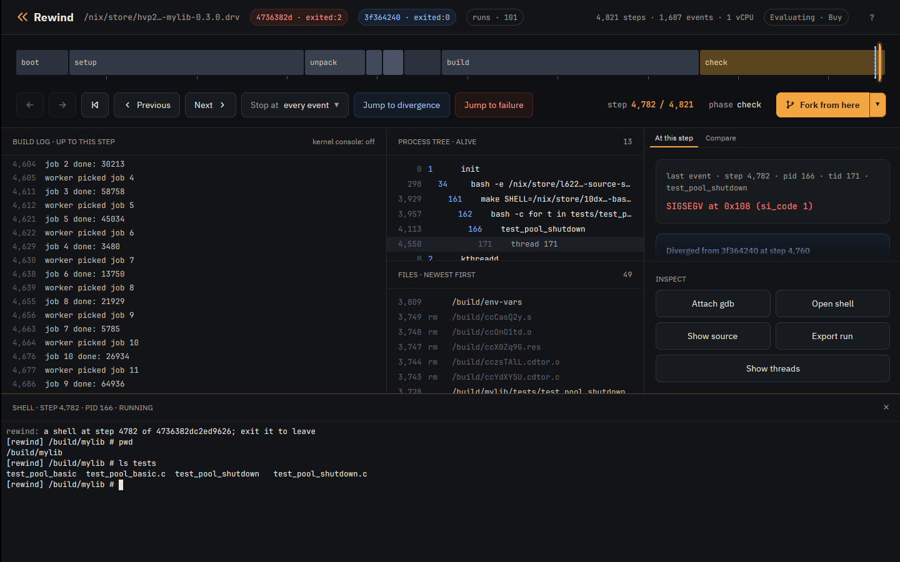
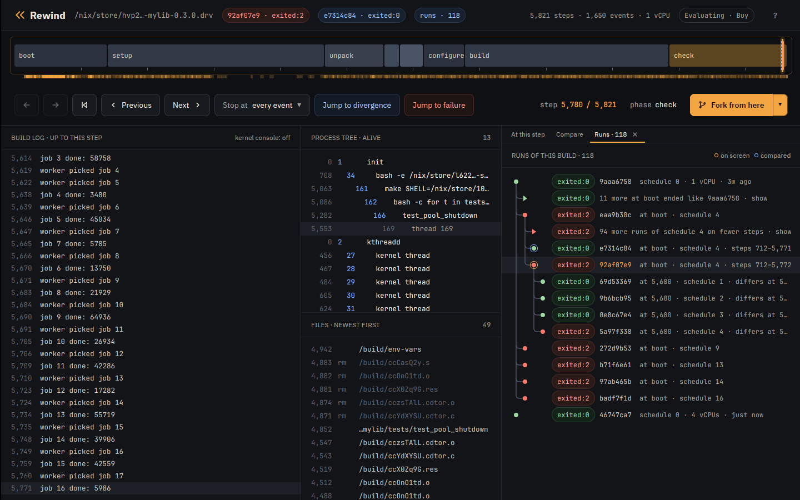
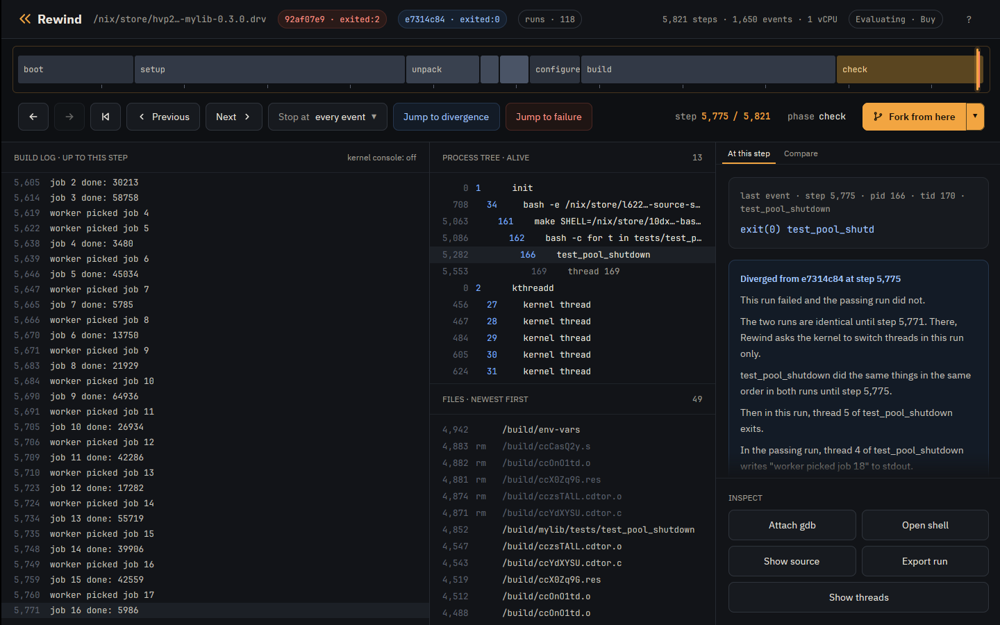
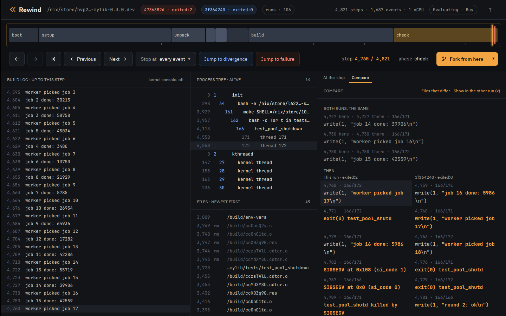
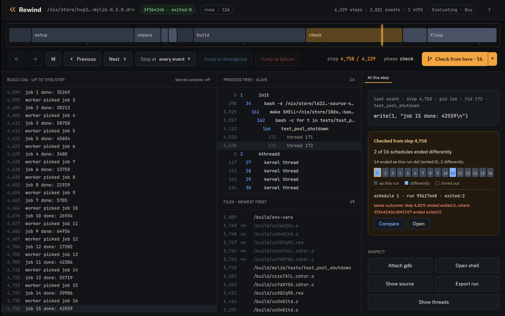
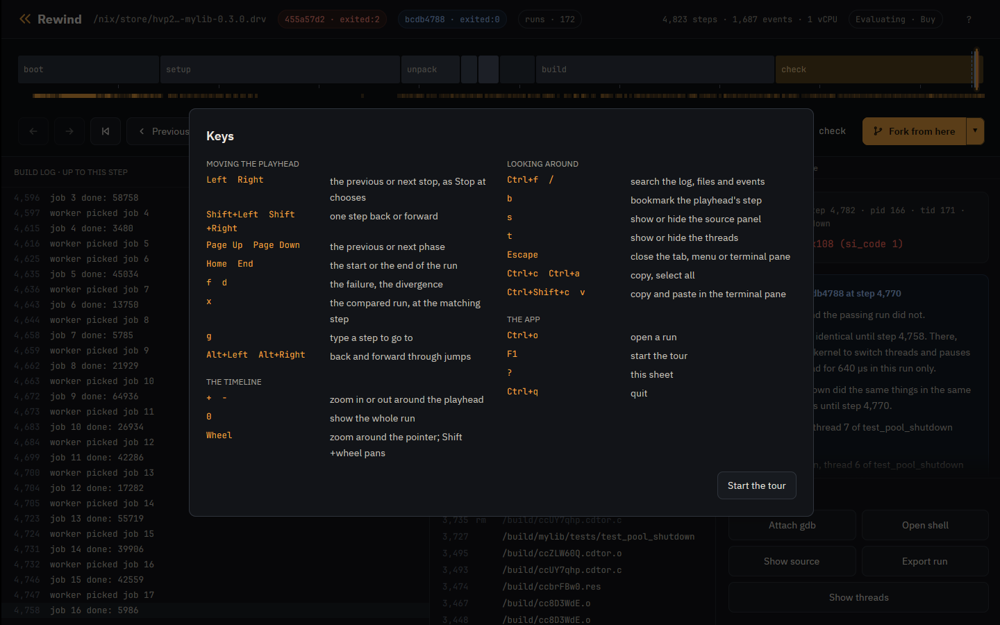

# Tutorial: advanced features

Short recipes for what the [Nix](tutorial-nix.md) and
[container](tutorial-container.md) tutorials leave out, each in the terminal
and in the desktop app. They use the Nix tutorial's runs and install.

## The runs

```console
$ rewind check --epoch 1790985600 github:fzakaria/rewindvm#mylib | grep -E 'ends differently|limited to|decides it|passing:|failing:|same run until|open both'
rewind: packing 62 store paths for mylib-0.3.0
schedule 4 ends differently from schedule 0; finding the step that decides it
schedule 4 limited to steps 712..5772 still ends differently
step 5771 decides it: a request to switch threads there makes the run fail
passing: run e7314c846bcd4c04, schedule 4 over steps 712..5771
failing: run 92af07e9945d3001, schedule 4 over steps 712..5772
the two are the same run until step 5771
open both in the desktop app: rewind open 92af07e9945d3001 5775 --compare e7314c846bcd4c04
```

The failing run crashes at step 5780.

## Find the line a thread was on

`rewind where` names the line of the program's own code a thread was on at a
step, skipping the C library and, in Rust, the standard library and
dependencies. By default it picks the thread of the step's event; at 5780
that is the worker that segfaulted:

```console
$ rewind where 92af07e9 5780
rewind: process 166 at step 5780; loading symbols for 4 of its files
rewind: fetched 3 source files from the VM
rewind: walking thread 169's stack in gdb
rewind: downloading debug info for libc.so.6; first time only
rewind: downloading debug info for libpthread.so.0; first time only
rewind: downloading debug info for ld-linux-x86-64.so.2; first time only
rewind: downloading source files of libc.so.6; each one only once
process 166 (test_pool_shutdown), thread 169, at step 5780
#0 worker (src/pool.c:77)
      75  			printf("job %d done: %ld\n", job, result & 0xffff);
      76  			fflush(stdout);
>     77  			p->queue->completed++;
      78  		}
      79  	}
arguments:
  arg = 0x5556f833c010
locals:
  q = <optimized out>
  job = 16
  result = 4092430570737637218
  p = 0x5556f833c010
called from #1 start_thread (pthread_create.c:454)
called from #2 __GI___clone3 (../sysdeps/unix/sysv/linux/x86_64/clone3.S:78)
```

Under the source come the frame's arguments and locals, as gdb's `info args`
and `info locals` print them: the worker had just reported job 16.

`--tid` picks another thread, on the CPU or not. At step 5780, where
the worker faults, the main thread is waiting to join the workers:

```console
$ rewind where 92af07e9 5780 --tid 166
rewind: process 166 at step 5780; loading symbols for 4 of its files
rewind: read 3 source files fetched from the VM earlier
rewind: walking thread 166's stack in gdb
rewind: downloading source files of libc.so.6; each one only once
process 166 (test_pool_shutdown), thread 166, at step 5780
#7 pool_shutdown (src/pool.c:128)
     126
     127  	for (int i = 0; i < POOL_WORKERS; i++)
>    128  		pthread_join(p->workers[i], NULL);
     129  	pthread_cond_destroy(&p->ready);
     130  	pthread_mutex_destroy(&p->lock);
arguments:
  p = 0x5556f833c010
locals:
  i = 0
called from #8 main (tests/test_pool_shutdown.c:24)
called from #9 __libc_start_call_main (../sysdeps/nptl/libc_start_call_main.h:59)
```

`--json` prints every frame, with its arguments and locals, where each is
and which one was chosen. For every frame of every thread, ask gdb for all
the stacks of the process:

```console
$ rewind gdb 92af07e9 5780 --pid 166 -- -batch -ex 'thread apply all bt' 2>/dev/null | grep -E '^Thread|src/|tests/'
#0  0x00005556d620d437 in worker (arg=0x5556f833c010) at src/pool.c:77
Thread 3 (Thread 1.169 (test_pool_shutd, on the CPU)):
#0  0x00005556d620d437 in worker (arg=0x5556f833c010) at src/pool.c:77
Thread 2 (Thread 1.166 (test_pool_shutd)):
#7  0x00005556d620d5b3 in pool_shutdown (p=p@entry=0x5556f833c010) at src/pool.c:128
#8  0x00005556d620d272 in main () at tests/test_pool_shutdown.c:24
Thread 1 (Thread 1.4194305 (the CPU, in test_pool_shutd 169)):
```

`rewind gdb` starts in the thread `rewind where` looks at, in its innermost
frame. `--tid` and `--frame` start it elsewhere, with frames numbered as
`where --json` numbers them. In the main thread's frame that `where` chose,
`pool_shutdown` has already set the queue to NULL:

```console
$ rewind gdb 92af07e9 5780 --tid 166 --frame 7 -- -batch -ex 'p p->queue'
rewind: process 166 at step 5780; loading symbols for 4 of its files
rewind: read 3 source files fetched from the VM earlier
rewind: gdb at step 5780 of 92af07e9945d3001
arch_local_irq_restore (flags=6) at ./arch/x86/include/asm/irqflags.h:146
146		return !(flags & X86_EFLAGS_IF);
[Switching to thread 2 (Thread 1.166)]
#0  __syscall_cancel_arch () at ../sysdeps/unix/sysv/linux/x86_64/syscall_cancel.S:56
56		ret
#7  0x00005556d620d5b3 in pool_shutdown (p=p@entry=0x5556f833c010) at src/pool.c:128
128			pthread_join(p->workers[i], NULL);
$1 = (struct queue *) 0x0
[Inferior 1 (process 1) detached]
```

`where` and gdb read each thread's registers from the VM kernel's task list,
so they work on runs recorded with a guest that lists its tasks, as these
were.

In the app, the s key opens the source panel at the line `rewind where` names,
with the frame's variables and the thread's frames below it; click a frame to
see its line and variables instead. The panel follows the playhead, and each
new step takes a few seconds since it forks the run.



## Find who wrote a value

The worker crashed because `p->queue` was NULL. `rewind blame` finds the
write that put a value there. Give it a step and an expression. It works out
the expression's address in the thread that `where` picks. Then it replays the
stretch of the run before the step, with that address in the CPU's debug
registers. If the stretch holds no write, it tries the stretch before that:

```console
$ rewind blame 92af07e9 --at 5780 'p->queue'
rewind: process 166 at step 5780; loading symbols for 4 of its files
rewind: read 3 source files fetched from the VM earlier
rewind: walking thread 169's stack in gdb
p->queue = 0x0   8 bytes at 0x5556f833c068, thread 169, pool.c:77

last written at step 5772 by thread 166 (test_pool_shutd)
  pool.c:125  pool_shutdown  p->queue = NULL;
  was 0x5556f833c090

other threads just after the write, in step 5772:
  thread 169  pool.c:75  worker  __syscall_cancel_arch
  thread 170  pool.c:45  run_job  __syscall_cancel_arch

searched back to step 5284, 1 keyframe window, 1 write, 0.7s
```

The main thread set `p->queue` to NULL on line 125, in `pool_shutdown`. It did
so at step 5772, 8 steps before the crash. blame also
prints the value before the write.

The last part shows where the other threads were just after the write. Thread
169 is the worker that crashes later. It was on line 75, printing. It
had already passed the check of `p->stopping` on line 74.

A step runs from one exit of the VM to the next, so a step can cover many
lines of the program. At the start of step 5772, the main thread had
not yet called `pool_shutdown`. `rewind where --after-write` looks just after
the write itself, with the address and size blame printed:

```console
$ rewind where 92af07e9 5772 --tid 166 --after-write 0x5556f833c068 --size 8
rewind: process 166 at step 5772; loading symbols for 4 of its files
rewind: read 3 source files fetched from the VM earlier
rewind: walking thread 166's stack in gdb
process 166 (test_pool_shutdown), thread 166, at step 5772, just after its write of the 8 bytes at 0x5556f833c068
#0 pool_shutdown (src/pool.c:125)
     123  	/* The bug: the queue goes before the workers are joined. */
     124  	free(p->queue);
>    125  	p->queue = NULL;
     126
     127  	for (int i = 0; i < POOL_WORKERS; i++)
arguments:
  p = 0x5556f833c010
locals:
  i = 0
called from #1 main (tests/test_pool_shutdown.c:24)
called from #2 __libc_start_call_main (../sysdeps/nptl/libc_start_call_main.h:59)
```

`--writes 2` goes back one more write. Here that is the `calloc` in
`pool_create`.

blame can only watch values in memory. gdb keeps some values in registers, such
as `job` here. For those, blame says it cannot watch them and lists the values
on the same line that it can watch.

`--reads` lists the reads as well as the writes. It takes several expressions
at once. It searches back to the start of the process, or to the step given
with `--since`. Here it searches the last 40 steps. The output below keeps only
lines 74 and 77 of the worker and lines 119 and 125 of `pool_shutdown`:

```console
$ rewind blame 92af07e9 --at 5780 'p->stopping' 'p->queue' --reads --since 5740
...
  step  thread           access  value               where
...
  5747  169 test_pool_shutd read    0                   pool.c:74  worker  if (!p->stopping) {  p->stopping
  5748  169 test_pool_shutd read    0x5556f833c090      pool.c:77  worker  p->queue->completed++;  p->queue
...
  5758  170 test_pool_shutd read    0                   pool.c:74  worker  if (!p->stopping) {  p->stopping
  5759  170 test_pool_shutd read    0x5556f833c090      pool.c:77  worker  p->queue->completed++;  p->queue
...
  5770  169 test_pool_shutd read    0                   pool.c:74  worker  if (!p->stopping) {  p->stopping
...
  5772  166 test_pool_shutd write   1                   pool.c:119  pool_shutdown  p->stopping = 1;  p->stopping
...
  5772  166 test_pool_shutd write   0x0                 pool.c:125  pool_shutdown  p->queue = NULL;  p->queue
  5773  170 test_pool_shutd read    1                   pool.c:74  worker  if (!p->stopping) {  p->stopping
...
  5777  169 test_pool_shutd read    0x0                 pool.c:77  worker  p->queue->completed++;  p->queue
...
searched back to step 5740, 1 keyframe window, 2 writes, 15 reads, 0.7s
```

Read in order, the rows show the race:

1. Thread 169 reads `p->stopping` as 0 on line 74. So it goes on to
   count its job.
2. The main thread sets `p->stopping` to 1, then sets `p->queue` to NULL.
3. Thread 169 reads `p->queue` on line 77 and gets NULL.

The worker does not hold the lock between line 74 and line 77. Nothing stops
the main thread from running in between.

In the app, the source panel underlines each value that blame can watch.
Hover over a value to see where it is kept, or why blame cannot watch it. Click
it to search. You can keep using the app while the search runs. The popover
counts the steps searched so far, and the timeline marks the stretch being
searched.

The answer names the write, the value before it, and where the other threads
were. Click the write, or the button, to see the writer just after the write;
click another thread to see it at that moment. The other buttons show the reads
with one lane per thread, or blame the write before this one. The popover moves
by its top line. At the step where the run failed, the panel
starts searching for the failing line's values before you click.


## Find the step that decides it

`check` names step 5771 as the one that decides it. Its passing run is the
same schedule without that step, so the two runs are the same machine until
5771, where only the failing run gets a request to switch threads, and everything
they do differently follows from it. `rewind where` names the thread that was
on the CPU there:

```console
$ rewind where 92af07e9 5771
rewind: process 166 at step 5771; loading symbols for 4 of its files
rewind: read 3 source files fetched from the VM earlier
rewind: walking thread 169's stack in gdb
process 166 (test_pool_shutdown), thread 169, at step 5771
#14 worker (src/pool.c:75)
      73  		long result = run_job(job);
      74  		if (!p->stopping) {
>     75  			printf("job %d done: %ld\n", job, result & 0xffff);
      76  			fflush(stdout);
      77  			p->queue->completed++;
arguments:
  arg = 0x5556f833c010
locals:
  q = <optimized out>
  job = 16
  result = 4092430570737637218
  p = 0x5556f833c010
called from #15 start_thread (pthread_create.c:454)
called from #16 __GI___clone3 (../sysdeps/unix/sysv/linux/x86_64/clone3.S:78)
```

A worker checks `p->stopping` without the lock, prints its job, and then
counts it through `p->queue`, which `pool_shutdown` frees. At step
5771 the worker has made its check and is printing; a request to switch threads
there holds it before the count. The test's main thread runs meanwhile, sees
half the jobs done, and shuts the pool down, setting the queue to NULL, and
the worker faults on it 9 steps later. Without that step's
perturbation, the worker counts first and the test passes.

`check --where` looks up both threads itself: the one on the CPU at the
deciding step, and the one at the failing run's first differing event. Each
lookup forks the run and starts gdb, so it is opt-in:

```console
$ rewind check --where --epoch 1790985600 github:fzakaria/rewindvm#mylib 2>/dev/null | sed -n '/^where the threads were/,/first event that differs$/p'
where the threads were:
        5771   166/169   worker (src/pool.c:75), on the CPU at the deciding step
        5775   166/170   start_thread (pthread_create.c:623), at the first event that differs
```

The first event that differs is the other worker, thread 170, ending:
it is in `start_thread`, glibc's code around a thread's function, on its way
out. With thread 169 held at the deciding step, the other worker
finds the queue empty and returns, where in the passing run thread
169 picked the next job first. That is the cause showing up before
the symptom: the held thread's fault at line 77, which `rewind where` showed
at the top of this page, comes 5 steps later, at step 5780.

In the app, the deciding step is a dashed blue mark on the timeline, before
the solid one where the runs' events first differ. Zoomed in around the crash:


## See which thread held the CPU

The VM has one CPU, so a race is an order of threads. Every context switch
in the VM is a step of its own, and `rewind threads` prints which thread held
the CPU over a window of steps, a line per stretch. Around the deciding step,
in both runs:

```console
$ rewind threads 92af07e9 --from 5762 --to 5780
      5762       5769          idle  swapper/0
      5770       5771       166/169  test_pool_shutd
      5772       5772       166/166  test_pool_shutd
      5773       5775       166/170  test_pool_shutd
      5776       5776     kernel 11  ksoftirqd/0
      5777       5780       166/169  test_pool_shutd
```

```console
$ rewind threads e7314c84 --from 5762 --to 5780
      5762       5769          idle  swapper/0
      5770       5776       166/169  test_pool_shutd
      5777       5777       166/166  test_pool_shutd
      5778       5780       166/170  test_pool_shutd
```

The lines match up to step 5771. From there the threads take the CPU in
another order, and in the failing run thread 169 holds it at the crash.
Every switch is a step, so no stretch is too short to appear.

In the app, the t key opens the Threads tab: a lane per thread around where
the two runs part, this run's above the compared run's, with a bar wherever
the thread held the CPU. Ctrl and the wheel zoom the lanes and Shift and the
wheel pan them. Clicking a bar moves the playhead there. The band under the
timeline is darker where the switches are dense, which says where to look,
and the Stop at menu offers the switches of the thread on the CPU at the
playhead, so Next goes to where that thread took the CPU or lost it:



## Watch both sides of the race

A watchpoint finds who freed the queue the crash reads. Break in a worker so
`p` is in scope, watch `p->queue`, and continue:

```console
$ rewind gdb 92af07e9 5734 -- -batch -ex 'break src/pool.c:74' -ex continue -ex 'watch -l p->queue' -ex 'delete 1' -ex continue -ex 'bt 2' -ex 'break src/pool.c:77 if p->queue == 0' -ex continue -ex 'bt 1'
rewind: step 5734 ran in process 166; loading symbols for 4 of its files
rewind: read 3 source files fetched from the VM earlier
rewind: gdb at step 5734 of 92af07e9945d3001
arch_local_irq_restore (flags=518) at ./arch/x86/include/asm/irqflags.h:146
146		return !(flags & X86_EFLAGS_IF);
[Switching to thread 4 (Thread 1.170)]
#0  __syscall_cancel_arch () at ../sysdeps/unix/sysv/linux/x86_64/syscall_cancel.S:56
56		ret
Breakpoint 1 at 0x5556d620d3a9: file src/pool.c, line 74.
[Switching to Thread 1.169]

Thread 3 hit Breakpoint 1, worker (arg=0x5556f833c010) at src/pool.c:74
74			if (!p->stopping) {
Hardware watchpoint 2: -location p->queue
[Switching to Thread 1.166]

Thread 2 hit Hardware watchpoint 2: -location p->queue

Old value = (struct queue *) 0x5556f833c090
New value = (struct queue *) 0x0
pool_shutdown (p=p@entry=0x5556f833c010) at src/pool.c:128
128			pthread_join(p->workers[i], NULL);
#0  pool_shutdown (p=p@entry=0x5556f833c010) at src/pool.c:128
#1  0x00005556d620d272 in main () at tests/test_pool_shutdown.c:24
Breakpoint 3 at 0x5556d620d433: file src/pool.c, line 77.
[Thread 1.170 exited]
[Switching to Thread 1.169]

Thread 3 hit Breakpoint 3, worker (arg=0x5556f833c010) at src/pool.c:77
77				p->queue->completed++;
#0  worker (arg=0x5556f833c010) at src/pool.c:77
[Inferior 1 (process 1) detached]
```

The first stop is `main` nulling the queue in `pool_shutdown`, the second the
worker reading it. Watchpoints are the CPU's four debug registers, so the VM
runs at full speed until one fires. `watch` and `awatch` work; x86 has no
`rwatch`. At user addresses they stop only in the process gdb started in.

In the app, Attach gdb opens the same session under the timeline:



## Run backwards to the write

gdb gives the same answer as blame and can go on from there: it can run the
fork backwards. From the crash itself, watch the pointer the worker read and
run back to the last write to it:

```console
$ rewind gdb 92af07e9 5780 -- -batch -ex 'watch -l p->queue' -ex reverse-continue -ex 'bt 2'
rewind: step 5780 ran in process 166; loading symbols for 4 of its files
rewind: read 3 source files fetched from the VM earlier
rewind: gdb at step 5780 of 92af07e9945d3001
arch_local_irq_restore (flags=6) at ./arch/x86/include/asm/irqflags.h:146
146		return !(flags & X86_EFLAGS_IF);
[Switching to thread 3 (Thread 1.169)]
#0  0x00005556d620d437 in worker (arg=0x5556f833c010) at src/pool.c:77
77				p->queue->completed++;
Hardware watchpoint 1: -location p->queue
[New Thread 1.170]
[Switching to Thread 1.166]

Thread 2 hit Hardware watchpoint 1: -location p->queue

Old value = (struct queue *) 0x0
New value = (struct queue *) 0x5556f833c090
pool_shutdown (p=p@entry=0x5556f833c010) at src/pool.c:125
125		p->queue = NULL;
#0  pool_shutdown (p=p@entry=0x5556f833c010) at src/pool.c:125
#1  0x00005556d620d272 in main () at tests/test_pool_shutdown.c:24
[Inferior 1 (process 1) detached]
```

The fork stops before `main` nulls the queue in `pool_shutdown`. Going back,
gdb shows the values swapped: the old value is the one after the write.
`reverse-stepi`, `reverse-next`, `reverse-finish` and `reverse-continue` to a
breakpoint work too. Rewind replays the run from the step's start to go back,
so a step back takes a moment, and longer under exit time, which single-steps
the way. A fork whose memory or registers gdb changed cannot go back.

## Follow the fault into the kernel

`rewind gdb` has the VM kernel's symbols too. Stop where the kernel sends the
SIGSEGV, and use its own gdb scripts:

```console
$ rewind gdb 92af07e9 5771 -- -batch -ex 'break force_sig_fault' -ex continue -ex 'bt 4' -ex 'pipe lx-ps | tail -4' -ex 'pipe lx-dmesg | tail -2'
rewind: step 5771 ran in process 166; loading symbols for 4 of its files
rewind: read 3 source files fetched from the VM earlier
rewind: gdb at step 5771 of 92af07e9945d3001
arch_local_irq_restore (flags=518) at ./arch/x86/include/asm/irqflags.h:146
146		return !(flags & X86_EFLAGS_IF);
[Switching to thread 3 (Thread 1.169)]
#0  __syscall_cancel_arch () at ../sysdeps/unix/sysv/linux/x86_64/syscall_cancel.S:56
56		ret
Downloading 133.41 K source file /build/linux-7.2.8/kernel/signal.c...
Breakpoint 1 at 0xffffffff812c4530: file kernel/signal.c, line 1757.
[Thread 1.170 exited]
[Switching to Thread 1.4194305]

Thread 1 hit Breakpoint 1, force_sig_fault (sig=11, code=1, addr=0x108) at kernel/signal.c:1757
1757	{
#0  force_sig_fault (sig=11, code=1, addr=0x108) at kernel/signal.c:1757
#1  0xffffffff81e71750 in handle_page_fault (regs=0xffffc900001cbf58, error_code=6, address=264) at arch/x86/mm/fault.c:1483
#2  exc_page_fault (regs=0xffffc900001cbf58, error_code=6) at arch/x86/mm/fault.c:1536
#3  0xffffffff810012a6 in asm_exc_page_fault () at ./arch/x86/include/asm/idtentry.h:595
0xffff888003bf6e40  161  make
0xffff888003811f80  162  bash
0xffff888003810000  166  test_pool_shutd
0xffff888003810fc0  169  test_pool_shutd
[    0.215429] test_pool_shutd[169]: segfault at 108 ip 00005556d620d437 sp 00007feee6667e10 error 6 in test_pool_shutdown[1437,5556d620d000+1000] likely on CPU 0 (core 0, socket 0)
[    0.215434] Code: fa 48 8d 35 2a 0c 00 00 bf 02 00 00 00 b8 00 00 00 00 e8 ac fc ff ff 48 8b 05 b5 2b 00 00 48 8b 38 e8 8d fc ff ff 49 8b 46 58 <83> 80 08 01 00 00 01 e9 b5 fe ff ff 55 48 89 e5 41 54 53 be 78 00
[Inferior 1 (process 1) detached]
```

The kernel's DWARF comes from `rewindvm.cachix.org` with Nix, and from the
debug tarball next to `rewind` without. The app's build log shows the kernel's
messages beside the program's with kernel console on:



## Use your own gdb

`--listen` serves the fork for a gdb started elsewhere, such as an IDE's, and
prints the command line that loads the same symbols:

```console
$ rewind gdb 92af07e9 5780 --listen 127.0.0.1:1234
rewind: step 5780 ran in process 166; loading symbols for 4 of its files
rewind: read 3 source files fetched from the VM earlier
rewind: gdb at step 5780 of 92af07e9945d3001; connect with: gdb -q -iex 'add-auto-load-safe-path /nix/store/h4wfwic161kxrr74jlzla5lsm28hgary-glibc-2.44-25' -iex 'set debuginfod enabled on' -iex 'set debuginfod urls http://127.0.0. ...
```

## Bring tools into the VM

`rewind shell --with` adds a Nix package to the shell, without changing the
run. Here binutils disassembles the faulting instruction:

```console
$ printf 'objdump -d --no-show-raw-insn --start-address=0x142c --stop-address=0x143e tests/test_pool_shutdown | tail -4; exit\n' | rewind shell 92af07e9 5780 --pid 166 --with nixpkgs#binutils
rewind: packing 21 store paths for --with
rewind: a shell at step 5780 of 92af07e9945d3001; exit it to leave
[rewind] /build/mylib # objdump -d --no-show-raw-insn --start-address=0x142c --stop-address=0x143e tests/test_pool_shutdown | tail -4; exit
    142c:	mov    (%rax),%edi
    142e:	call   10c0 <fflush@plt>
    1433:	mov    0x58(%r14),%rax
    1437:	addl   $0x1,0x108(%rax)
```

In the app, Open shell starts a shell at the playhead in the terminal pane,
in the crashing process's working directory:



## Give programs more CPUs

The VM has one vCPU, so by default programs see one CPU and Nix builds run
one job at a time. `--cores` tells them there are more, and the extra threads
interleave on the one vCPU:

```console
$ rewind nix --cores 4 --epoch 1790985600 github:fzakaria/rewindvm#mylib
...
rewind: run 46747ca7b99570bf exited:0 after 6038 steps, 0.215s virtual, 0.656s wall (poweroff)
/nix/store/f6a9gy362szw6nxx3ikrklr8glr6rdln-mylib-0.3.0 a9d703ba89774f3d  matches your store, rewindvm.cachix.org
```

```console
$ printf 'nproc; echo $NIX_BUILD_CORES; exit\n' | rewind shell 46747ca7 2680 --pid 110
rewind: a shell at step 2680 of 46747ca7b99570bf; exit it to leave
[rewind] /build/mylib # nproc; echo $NIX_BUILD_CORES; exit
4
4
```

Go programs see the extra CPUs too, and Go's garbage collector can then
spin waiting for a thread that never runs. Run them with `GOGC=off` if they
fit in the VM's memory.

## Steer the perturbation

`check --schedules N` tries more or fewer schedules, `--all` all of them.
`rewind fork` asks which schedules fail from a given step:

```console
$ rewind fork 92af07e9 5680 --schedule 1 --quiet
rewind: run 69d53369f3d544b5 exited:0 after 7877 steps, 0.241s virtual, 0.165s wall (poweroff)
rewind: the fork first differs from its parent at step 5722
rewind: open it beside its parent in the desktop app: rewind open 69d53369f3d544b5 5722 --compare 92af07e9945d3001

$ rewind fork 92af07e9 5680 --schedule 2 --quiet
rewind: run 9b6bcb95096c0dfa exited:0 after 7812 steps, 0.240s virtual, 0.111s wall (poweroff)
rewind: the fork first differs from its parent at step 5704
rewind: open it beside its parent in the desktop app: rewind open 9b6bcb95096c0dfa 5704 --compare 92af07e9945d3001

$ rewind fork 92af07e9 5680 --schedule 3 --quiet
rewind: run 0e8c67e46ae413ee exited:0 after 7950 steps, 0.242s virtual, 0.115s wall (poweroff)
rewind: the fork first differs from its parent at step 5684
rewind: open it beside its parent in the desktop app: rewind open 0e8c67e46ae413ee 5684 --compare 92af07e9945d3001

$ rewind fork 92af07e9 5680 --schedule 4 --quiet
rewind: run 5a97f338f8c7c6f8 exited:2 after 5822 steps, 0.216s virtual, 0.064s wall (poweroff)
rewind: the fork first differs from its parent at step 5799
rewind: open it beside its parent in the desktop app: rewind open 5a97f338f8c7c6f8 5799 --compare 92af07e9945d3001
```

The app's Runs tab, or the runs pill in its header, shows every run of the
build, with forks under the run and step they branched from:



Fork from here forks the run at the playhead with the next schedule. Clicking
a run opens it compared with the run it hangs under; right-clicking offers
more.

## Find a run again

A command takes a run by its id or a prefix of it, by `@` for the newest run
and `@2`, `@3` and on for the ones before it, by name, or by directory.
`rewind ls` lists runs newest first, and filters them:

```console
$ rewind ls -n 3
5a97f338f8c7c6f8  exited:2          5822 steps  mylib-0.3.0 (fork of 92af07e9945d3001 at 5680, schedule 4)
0e8c67e46ae413ee  exited:0          7950 steps  mylib-0.3.0 (fork of 92af07e9945d3001 at 5680, schedule 3)
9b6bcb95096c0dfa  exited:0          7812 steps  mylib-0.3.0 (fork of 92af07e9945d3001 at 5680, schedule 2)

$ rewind ls --forks-of 92af07e9 --status failed
5a97f338f8c7c6f8  exited:2          5822 steps  mylib-0.3.0 (fork of 92af07e9945d3001 at 5680, schedule 4)
```

`--name` and `--since` (`30m`, `2h`, `7d` or a date) filter too.

`rewind open` starts the app on a run, at a step and beside another run.
`check` and `fork` print the command that opens what they made:

```console
$ rewind open 92af07e9 5780 --compare e7314c84
```

## Rebuild a run exactly

A run's id is the hash of its inputs, which its `manifest.json` lists, so the
same command follows the same run on a machine with the same CPU vendor and
guest. `rewind show` prints that command with every input spelled out,
including the epoch, which defaults to the start of the day the run was made.
For a fork it prints its parents' commands first. `@`, the newest run, is the
schedule 4 fork:

```console
$ rewind show @
5a97f338f8c7c6f8  exited:2          5822 steps  mylib-0.3.0 (fork of 92af07e9945d3001 at 5680, schedule 4)
...
rewind nix /nix/store/...-mylib-0.3.0.drv --epoch 1790985600 --schedule 4 --schedule-from 712 --schedule-until 5772 --cpu v3 --clock branches --name mylib-0.3.0  # 92af07e9945d3001
rewind fork 92af07e9945d3001 5680 --schedule 4  # 5a97f338f8c7c6f8
```

The failing run's command makes it again, with the same id:

```console
$ rewind show 92af07e9 | tail -1 | sh
...
rewind: run 92af07e9945d3001 exited:2 after 5821 steps, 0.216s virtual, 0.541s wall (poweroff)
```

## Compare any two runs

`rewind diff` compares every event of two runs, where `check` compares only
the failing program's:

```console
$ rewind diff e7314c84 92af07e9
first difference at event 1627: step 5772 on the left, step 5775 on the right
  both        5759   166/170   write(1, "job 15 done: 42559\n")
  both        5760   166/170   write(1, "worker picked job 17\n")
  both        5771   166/169   write(1, "job 16 done: 5986\n")
  left        5772   166/169   write(1, "worker picked job 18\n")
  left        5780   166/170   thread exit(test_pool_shutd) exited:0
  left        5791   166/169   thread exit(test_pool_shutd) exited:0
  left        5794   166/166   write(1, "round 1: ok\n")
  right       5775   166/170   thread exit(test_pool_shutd) exited:0
  right       5778     0/0     console "[    0.215428] test_pool_shutd[169]: segfault at 108 ip 00005556d620d437 sp 00007feee6667e10 error 6 in test_pool_shutdown[1437,5556d620d000+1000] likely on CPU 0 (core 0, socket 0)"
  right       5779     0/0     console "[    0.215433] Code: fa 48 8d 35 2a 0c 00 00 bf 02 00 00 00 b8 00 00 00 00 e8 ac fc ff ff 48 8b 05 b5 2b 00 00 48 8b 38 e8 8d fc ff ff 49 8b 46 58 <83> 80 08 01 00 00 01 e9 b5 fe ff ff 55 48 89 e5 41 54 53 be 78 00"
  right       5780   166/169   SIGSEGV code=1 addr=0x108
```

In the app, any run compared with another shows where they part, on the
timeline and in the divergence card:



The card's Compare side by side link opens the Compare tab: the last events
both runs shared, then each run's next events side by side, with what differs
in amber. The x key swaps to the other run at the matching step, and x again
comes back:



## Script it

`run`, `nix` and `fork` exit with the job's status, as a shell would report
it, so a shell loop can ask which schedules fail from a step:

```console
$ for s in 5 6 7 8; do rewind fork 92af07e9 5680 --schedule $s --quiet 2>/dev/null; echo "schedule $s: exit $?"; done
schedule 5: exit 0
schedule 6: exit 0
schedule 7: exit 0
schedule 8: exit 0
```

`check` exits 1 when a run fails a property, by default by ending
differently from schedule 0, and 0 when none does, `diff`
1 when the runs differ, `cat` 3 when the file did not exist at the step, and
`doctor` 1 when this machine cannot record runs. With `--json`, commands
print JSON for a program to read in place of their text: one object, or from
`ls` and `events` one a line. `check --json` lists each run it tried under
`schedules`, with the properties the run violated under `violations`.

```console
$ rewind ls --forks-of 92af07e9 --status failed --json | jq -r .id
5a97f338f8c7c6f8

$ rewind diff e7314c84 92af07e9 --json | jq -c '.divergence | {left_step, right_step}'
{"left_step":5772,"right_step":5775}
```

## Judge runs by properties

By default `check` fails a run that ends differently from schedule 0.
`--property` replaces that test with others, such as `no-crash` or
`single-writer=GLOB`, and can be repeated. `rewind check --help` lists the
built-in properties, and the [properties tutorial](tutorial-properties.md)
explains each one.

A program that calls the [Rewind
SDK](https://github.com/fzakaria/rewindvm/tree/main/sdk) asserts from the
inside: `always` must hold every time it runs, and `sometimes` must hold in
at least one run. Check adds the `sdk` property when schedule 0 calls the
SDK, and the app marks each failed assertion in red above the track.

A property can also be a script. It gets the run in `$REWIND_RUN`, can read
it with `rewind log`, `rewind events --json` or `rewind cat`, and exits 0
when the run is correct or 1 with the reason on its first line. This one
checks that `bank`'s deposits add up:

```console
$ cat adds-up.sh
#!/bin/sh
# The deposits add up: bank prints its balance and what it expected.
line=$(rewind log "$REWIND_RUN" | grep "^balance ")
test "$line" = "balance 400, expected 400" && exit 0
echo "$line"
exit 1
```

```console
$ rewind check --epoch 1790985600 --property script=./adds-up.sh github:fzakaria/rewindvm#bank | grep -E 'decides it|failing run violates adds-up'
rewind: packing 62 store paths for bank-0.1.0
schedule 1 violates adds-up, sdk; finding the step that decides it
step 3356 decides it: a request to switch threads there makes the run violate adds-up, sdk
failing run violates adds-up: balance 390, expected 400
```

`--properties` reads properties from a file, one a line, so a repository
can keep them beside its tests. A script's path in the file is relative to
the file's directory:

```console
$ cat rewind.properties
# What a correct bank run is.
no-crash
script=adds-up.sh

$ rewind check --epoch 1790985600 --properties rewind.properties github:fzakaria/rewindvm#bank | grep 'decides it'
schedule 1 violates adds-up, sdk; finding the step that decides it
step 3356 decides it: a request to switch threads there makes the run violate adds-up, sdk
```

## Count the schedules that fail from a step

`rewind fork` tries one schedule from a step. `check --run` tries many, each a
fork at `--schedule-from`, with the run itself as schedule 0. `--no-narrow`
stops at the count. From the deciding step of the passing run:

```console
$ rewind check --run e7314c84 --schedule-from 5771 --schedules 16 --all --no-narrow
schedule   0: exited:0             7311 steps  a9d703ba8977  run e7314c846bcd4c04
schedule   1: exited:0             7892 steps  a9d703ba8977  run 48884099652e6069
schedule   2: exited:0             7869 steps  a9d703ba8977  run 78e8447f544e4b46
schedule   3: exited:2             5854 steps    run d3a1a44f7a48c472
schedule   4: exited:2             5822 steps    run 38c7dd6e098acdd2
schedule   5: exited:0             7777 steps  a9d703ba8977  run 35cb69ce10c70fe7
schedule   6: exited:2             5840 steps    run 25aa026d96ccec13
schedule   7: exited:2             5826 steps    run aa7b41978f2fb4a6
schedule   8: exited:0             7875 steps  a9d703ba8977  run 02d0f8d8372610f9
schedule   9: exited:2             5825 steps    run 2fc754576cc0d768
schedule  10: exited:2             5828 steps    run 272941b80cbe2a55
schedule  11: exited:0             7823 steps  a9d703ba8977  run 1c5fb03094b5131f
schedule  12: exited:0             7890 steps  a9d703ba8977  run b944f7f7985dff10
schedule  13: exited:2             5826 steps    run faa34f63f43f61df
schedule  14: exited:0             7818 steps  a9d703ba8977  run ada8299e0708e2ba
schedule  15: exited:2             5832 steps    run e8465c52013e2d91
schedule  16: exited:2             5827 steps    run 5f354d4f876f3276
9 of 16 other schedules ended differently
```

9 of the 16 crash. Without `--no-narrow`, `check --run` narrows the first of
them to the step that decides it, as for a build.

In the app, the chevron beside Fork from here turns it into Check from here,
which runs the schedules from the playhead and fills a cell per schedule:
grey for ended as this run did, blue for differently. Pick a cell to compare
with or open its run:



## Hold a task off the CPU for longer

A stall holds the running task off the CPU for at most 1.28 ms. A race whose
window includes a sleep, a timer or slow I/O in another task needs a longer
hold. This program gives eight threads 20 ms to start, built static:

```console
$ printf '#include <pthread.h>\n#include <stdio.h>\n#include <time.h>\n#include <unistd.h>\nvolatile int ready[8];\nvoid *work(void *i) { write(1, "started\\n", 8); ready[(long)i] = 1; return 0; }\nint main(void) {\n  pthread_t t[8];\n  for (long i = 0; i < 8; i++) pthread_create(&t[i], 0, work, (void *)i);\n  nanosleep(&(struct timespec){0, 20000000}, 0); /* 20 ms to start */\n  for (int i = 0; i < 8; i++) if (!ready[i]) { printf("worker %%d not ready\\n", i); return 1; }\n  puts("every worker ready");\n}\n' > ready.c
$ mkdir -p ready/bin
$ nix shell nixpkgs#pkgsStatic.stdenv.cc -c x86_64-unknown-linux-musl-cc -static -o ready/bin/ready ready.c
```

No schedule stalls a thread for 20 ms by default:

```console
$ rewind check --root ready --schedules 64 --all --no-narrow -- /bin/ready
...
same result under all 65 schedules
```

`--stall-max` on `run`, `nix`, `check` and `fork` raises the longest stall,
up to 1 s:

```console
$ rewind check --root ready --stall-max 50ms -- /bin/ready | grep -E 'ends differently|limited to|decides it|passing:|failing:'
schedule 19 ends differently from schedule 0; finding the step that decides it
schedule 19 limited to steps 719..721 still ends differently
step 720 decides it: a request to switch threads and a 40.96 ms pause of the running thread there makes the run fail
passing: run 89de083dff4c5f1e, schedule 19 over steps 719..720, stalls up to 50 ms
failing: run 80d5d7650d649d60, schedule 19 over steps 719..721, stalls up to 50 ms
```

The same steps stall, one exit in 128, but each stall picks one of the
doublings of 10 µs up to the maximum, 14 of them for 50 ms, so fewer stalls
are short. How often a race turns up then depends on how long it needs a
thread held: 32 schedules of mylib crash 11 times by default and
10 times with `--stall-max 100ms`, in 3.5 s and 3.6 s. A stall is virtual time, so the guest's clock
moves further, and a program's own timeouts see the extra time. The maximum is
part of each run's spec, so `rewind show`, a replay and a fork of the run keep
the maximum, and a run made without the flag keeps its id. A fork's own
schedule takes the default unless it is given `--stall-max` too.

## Try other seeds from a step

A fork keeps its parent's randomness unless you reseed it. `rewind fork
--seed` reseeds the VM's randomness at the fork's step. `check --run
--seeds` tries the run's own seed and several others, each a fork of the
run reseeded at `--schedule-from`. `hash-order`'s test depends on the order
of a Rust `HashSet`, which Rust draws from that randomness:

```console
$ rewind nix -q --epoch 1790985600 --name hash-order github:fzakaria/rewindvm#hash-order
...
/nix/store/8fzgvvjf4iffwijx3njlhg40m0xxnlw4-hash-order-0.1.0 83f239c2e3135166  not in your store or 6 caches
```

```console
$ rewind check --run hash-order --seeds 8 --schedules 0 | grep -E 'decides it|passing:|failing:'
seed 2 decides it: under schedule 0, seed 0 passes and seed 2 fails
passing: run 2e9bbd52744f599e, seed 0, schedule 0
failing: run 5cbff842b5c7b82d, seed 2 from step 703, schedule 0
```

## List directories in another order

Inside the VM a directory lists its entries in the same order in every run,
so a build that depends on that order never differs there. On a real
machine, ext4 lists a directory in an order set when the disk was formatted.
The kernel argument `rewind.dirents=N` lists every directory the build sees
in the order of a hash of each name keyed by N, as another ext4 disk would;
0 keeps the usual order. The key is part of the run, so a run made with one
replays:

```console
$ rewind nix --kernel-args rewind.dirents=2 github:fzakaria/rewindvm#mylib
```

`rewind check --dirents 3` builds under keys 1 to 3 besides the stock
order, a line each, and reports the first key whose build ends differently;
`rewind diff --outputs` shows what it changed. setuptools 80.9.0 builds a
wheel that names its own version as `1.0` under key 2, because it reads its
version from whichever `.egg-info` directory lists first.
[Directory order](design.md#directory-order) in the design notes says how
the kernel does it.

## Move around a long run

Builds of larger projects run to hundreds of thousands of steps. The app has
keys to jump to a step, step between events of one kind, bookmark, search and
zoom the timeline. The ? key lists them all:



## Hand a failure to someone else

```console
$ rewind export 92af07e9 --replayable -o crash.rwd
rewind: wrote crash.rwd (202.6 MB)

$ REWIND_HOME=elsewhere rewind import crash.rwd
92af07e9945d3001  exited:2          5821 steps  mylib-0.3.0

$ REWIND_HOME=elsewhere rewind replay 92af07e9
identical to the recording: 1650 events, 1839 context switches and 1476 read and write records over 5821 steps, and the whole machine at its 6 keyframes
```

A replayable export carries the keyframes, the image and the VM's kernel, and
replays on any machine with the same CPU vendor. Without `--replayable` it is
the events alone, 26.8 KB: enough to read and to scrub in the app, whose
Export button writes the replayable kind. Both kinds carry the run's
bookmarks.

The other machine also needs the features of the run's CPU model. A run
without `--cpu` gets `v3`, whose features include ERMS, the fast `rep movsb`
flag. On a host that lacks only ERMS it gets `v3-compat` instead, the same CPU
with ERMS hidden, and rewind prints a line saying so. A `v3` run needs a host
with ERMS, and a `v3-compat` run replays on hosts with or without it. A replay
on a host without the model's features names what is missing and where the
run replays, and `rewind doctor` says which model a run gets on a machine.

## Which clock

```console
$ rewind pmu status
cpu: AMD Zen (family 25)
amd workaround (MSR 0xc0011020 bit 54): set by `rewind pmu enable` this boot
perf_event_paranoid: 2
probe branches: 3000000 branches, as built
probe locked: 2000000 branches, as built
probe not-branches: 1000000 branches, as built
probe exits: 8192 branches, as built
self-test: 58071879 and 58071879 branches, exact at every exit
runs will use counter time
```

With counter time the VM's clock follows the work done inside it; with exit
time computation takes no virtual time. `--clock` picks one. [Counter
time](pmu.md) explains. `rewind doctor` checks the clock with KVM, gdb and
the rest of what rewind uses, and says what to do about each problem.

## Find where a run hung

A thread gives up the VM's one CPU only at a step, so a loop that makes no
system call keeps it, and the run hangs. `--timeout` stops a run after that
many seconds on your machine. When the guest had gone a second or more
without an exit, rewind says where it was stuck. A program that spins, built
static with its symbols:

```console
$ printf 'volatile unsigned long n;\nint main(void) { for (;;) n++; }\n' > spin.c
$ mkdir -p spin/bin
$ nix shell nixpkgs#pkgsStatic.stdenv.cc -c x86_64-unknown-linux-musl-cc -static -g -o spin/bin/spin spin.c
```

```console
$ rewind run --root spin --timeout 5 --name spin -- /bin/spin
rewind: run 88df117b846118ad timed-out after 712 steps, 0.004s virtual, 5.010s wall (timed out computing without exits for 4.7s, in user space in main+15 (spin.c:2), process 34 (spin))
```

A run that timed out while still making exits was slow rather than stuck, and
says so. `rewind check` gives each perturbed schedule ten times as long as
schedule 0 took, at least a minute, and reports a stuck schedule the same
way. Schedule 0 itself has no limit, since a long build is no reason to stop
it, so a test suite that hangs there holds up the whole check. Give such a
suite `rewind check --timeout`, which bounds every schedule, schedule 0
included. `--status timed-out` lists the runs that timed out:

```console
$ rewind ls --status timed-out
88df117b846118ad  timed-out          712 steps  spin
```

## Keep the run directory tidy

Runs live under `~/.local/share/rewind`, or `REWIND_HOME`:

```console
$ REWIND_HOME=elsewhere rewind ls
9b6bcb95096c0dfa  exited:0          7812 steps  mylib-0.3.0 (fork of 92af07e9945d3001 at 5680, schedule 2)
69d53369f3d544b5  exited:0          7877 steps  mylib-0.3.0 (fork of 92af07e9945d3001 at 5680, schedule 1)
92af07e9945d3001  exited:2          5821 steps  mylib-0.3.0

$ REWIND_HOME=elsewhere rewind remove 9b6bcb95
removed 9b6bcb95096c0dfa
rewind: `rewind gc` removes the pages no run uses any more
```

`remove` takes a run with every run forked from it. To remove every fork and
keep the runs they came from, run
`rewind ls | awk '/fork of/ {print $1}' | xargs rewind remove`.
`prune --identical` removes forks that ran exactly as an older one did.

## What to read next

- [Design](design.md): how the machine is made deterministic, and its
  [limits](design.md#limits).
- The [case studies](case-studies/nix-gc-closure-sigpipe.md): these tools on
  bugs in real projects.
