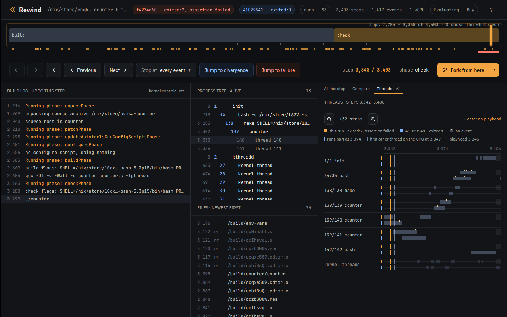

# Tutorial: schedule points

`rewind check` switches threads where the program makes a system call, and
nowhere else. A race between two system calls is in its reach, as the
[properties tutorial](tutorial-properties.md)'s `bank` is: each deposit
writes a ledger line between reading the balance and storing it. A race
with nothing between the read and the store is not, and no number of
schedules finds it. A schedule point is one line from the Rewind SDK that
puts a switch there.

The example is `counter` from
[examples](https://github.com/fzakaria/rewindvm/tree/main/examples): two
threads count hits on one counter, and each hit reads the count and stores
the count plus one. Install Rewind as the [Nix tutorial](tutorial-nix.md)
does.

## The race no schedule reaches

`counter` asserts with the SDK that the total adds up, so check judges each
run by the `sdk` property. Under 64 schedules, every run holds:

```console
$ rewind check --epoch 1790985600 github:fzakaria/rewindvm#counter
...
schedule  64: exited:0             5802 steps  e3f96e451c97  run 4732bb5fa08c09e8  holds
every property held under all 65 schedules
```

The threads do race. On a multicore host they run at the same instant, and
one hit in a while lands between the other thread's read and store. In the
VM they take turns on one CPU, and a thread gives the CPU up only at a
system call: thread creation, the join at the end, nothing inside the loop.
Each thread counts its ten hits in one stretch, and the total is always
twenty.

## Mark the place

Clone the repository to edit `counter`:

```console
$ git clone https://github.com/fzakaria/rewindvm
$ cd rewindvm
```

In `examples/counter/counter.c`, put a schedule point between the read and
the store:

```diff
@@ -27,6 +27,8 @@
 static void hit(void)
 {
 	long seen = atomic_load(&hits);
+	/* A schedule point: `rewind check` can switch threads here. */
+	rewind_point();
 	atomic_store(&hits, seen + 1);
 }

```

`rewind_point()` makes one exit from the VM, where a schedule can switch to
another thread or hold this one up, as at any system call. It writes
nothing to the run, and outside Rewind it does nothing.

Now check finds a schedule that loses hits, and narrows it to the point
that decides it:

```console
$ rewind check --epoch 1790985600 .#counter | grep -E 'decides it|passing:|failing:|failing run violates sdk'
rewind: packing 62 store paths for counter-0.1.0
schedule 1 violates same-outcome, sdk; finding the step that decides it
step 3345 decides it: a request to switch threads there makes the run violate same-outcome, sdk
passing: run 410295418cbaf73e, schedule 0
failing: run f4274e60fe2ef22b, schedule 1 over steps 3345..3346
failing run violates sdk: step 3375: always "hits-add-up" failed: 10 hits, expected 20
```

The run violates `same-outcome` too, since the job's build fails where
schedule 0's passed. `rewind threads` shows which thread held the CPU from
the stretch the deciding step falls in, in the failing run and in the
passing one it was forked from:

```console
$ rewind threads f4274e60 --from 3338 --to 3360
      3338       3346       139/140  counter
      3347       3359       139/141  counter
      3360       3360     kernel 11  ksoftirqd/0
```

```console
$ rewind threads 41029541 --from 3338 --to 3360
      3338       3351       139/140  counter
      3352       3360       139/141  counter
```

In the passing run thread 139/140 takes the CPU at step 3338
and keeps it until it has counted its hits and exits. In the failing run the
switch at step 3345 gives it one step, to its first point: it has
read the count and not stored it. Thread 139/141 then takes the CPU
at step 3347 and counts every one of its hits, and when thread
139/140 gets the CPU back it stores the count it read, over all of
them. Open the failing run beside the passing one, at the point, with the
thread lanes shown and zoomed in on the window around it:

```console
$ rewind open f4274e60 3345 --compare 41029541
```



The Threads panel has a lane per thread, with the stretches each held the
CPU: the failing run's above, the passing run's in blue under them. In the
failing run, thread 139/140's lane stops one step past the deciding
step and the other `counter` thread's lane runs until its hits are counted;
in the passing run, thread 139/140 keeps the CPU until it is done.

## Check the fix

Store only if the count is still what was read, and read it again if not:

```diff
@@ -23,13 +23,14 @@

 static atomic_long hits;

-/* The race: the count read here is stale by the time it is stored. */
+/* Stores only if the count is still what was read, and reads again if not. */
 static void hit(void)
 {
 	long seen = atomic_load(&hits);
 	/* A schedule point: `rewind check` can switch threads here. */
 	rewind_point();
-	atomic_store(&hits, seen + 1);
+	while (!atomic_compare_exchange_weak(&hits, &seen, seen + 1))
+		;
 }

 static void *count(void *arg)
```

The point stays. A switch there now finds the count changed, and the
compare and exchange reads it again instead of storing over it:

```console
$ rewind check --epoch 1790985600 .#counter | tail -1
rewind: packing 62 store paths for counter-0.1.0
every property held under all 65 schedules
```

## Where a point goes

A point goes where a switch would matter and no system call happens:
between a read and the store computed from it, in a lock-free structure's
push or pop, at the top of a retry loop. A codebase that wraps its atomics
in macros of its own gets a point at every atomic by adding one line to
that header. Each point costs one exit per visit, so a run with a point in
a hot loop is longer and slower, and a point in code that runs outside
Rewind costs one failed `open` the first time and nothing after.

The call is `rewind_point()` in C and C++, `rewind_sdk::point()` in Rust,
`rewind.Point()` in Go and `rewind_sdk.point()` in Python. The VM has one
CPU, so points find the orders of operations that lose an update or act on
a stale check. A bug that needs two CPUs to reorder memory is out of reach.

## What to read next

- [The properties tutorial](tutorial-properties.md): the `sdk` property and
  the assertions `counter` makes.
- [The SDK](https://github.com/fzakaria/rewindvm/tree/main/sdk): every
  call, in every language.
- [Design](design.md#limits): where the VM switches threads and why.
