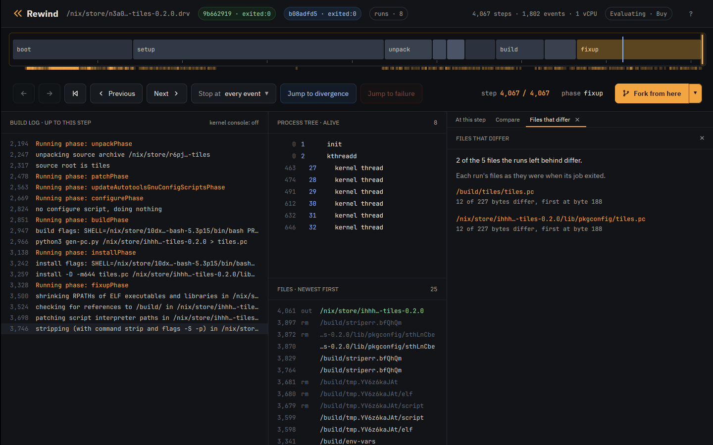
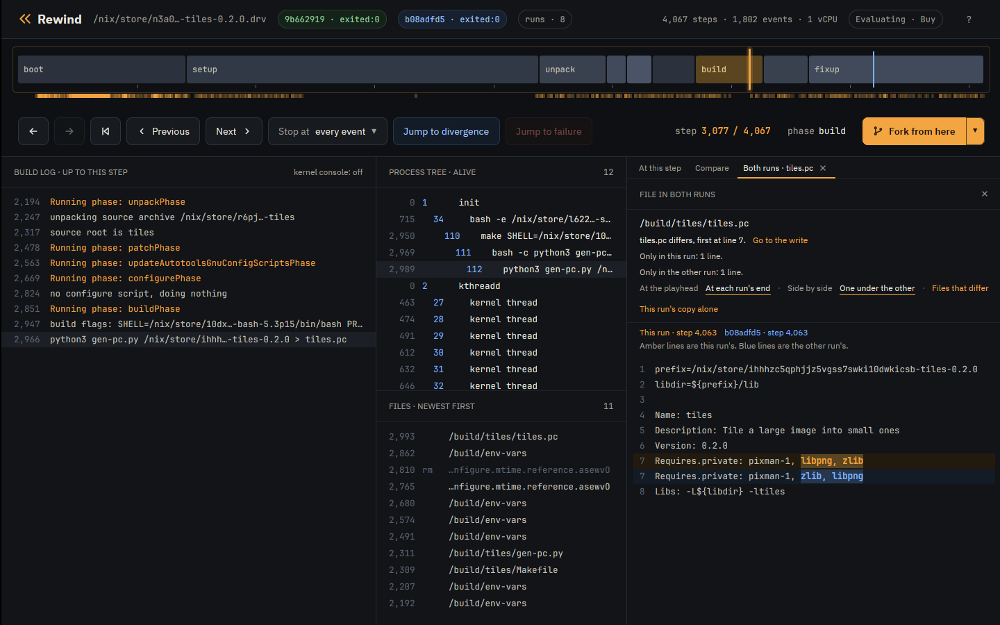

# Tutorial: reproducible builds

A reproducible build produces the same bytes from the same inputs. Builds
can also depend on details outside a Nix derivation, such as random seeds
or directory order. Rewind lets you vary those details, compare the
outputs, and find the code responsible for a difference.

This tutorial fixes two builds so their outputs agree across those
variations. The [deterministic derivations tutorial](tutorial-derivations.md)
uses another approach: pin the VM's environment in the derivation and keep
the build code unchanged. Fixing the code reduces what the output depends
on; pinning the environment makes those dependencies explicit.

The examples are `tiles` and `plugins` from
[examples](https://github.com/fzakaria/rewindvm/tree/main/examples), two
small builds that each write one text file. Install Rewind as the
[Nix tutorial](tutorial-nix.md) does.

## Build it under eight seeds

`tiles` writes its pkg-config file with a Python script that keeps the
packages it links against in a set. Python iterates a set in an order drawn
from its hash seed. nixpkgs pins that seed with `PYTHONHASHSEED=0`, and
`tiles` unsets it.

A run's seed decides every random number the build draws, including Python's
hash seed. `check` builds `tiles` under eight seeds, each with the default
schedule only:

```console
$ rewind check --epoch 1790985600 --seeds 8 --schedules 0 --all --no-narrow github:fzakaria/rewindvm#tiles
rewind: packing 75 store paths for tiles-0.2.0
rewind: 8 random seeds, each run under schedule 0 and 0 other schedules: 8 runs
seed  0 schedule   0: exited:0             4067 steps  d20b5efd388d  run 9b6629193ce4dd5a
seed  1 schedule   0: exited:0             4067 steps  0cd5db6c5c2c  run b08adfd5680f5398
seed  2 schedule   0: exited:0             4067 steps  d20b5efd388d  run 9527102793d0938f
seed  3 schedule   0: exited:0             4067 steps  0cd5db6c5c2c  run 1a5ab137db4e5a70
seed  4 schedule   0: exited:0             4067 steps  d20b5efd388d  run 03bc4f3cee97ff89
seed  5 schedule   0: exited:0             4067 steps  5e1f0a457cbe  run e0ad23c768101ce8
seed  6 schedule   0: exited:0             4067 steps  24f18f09c329  run b5f62c4e4da01d7c
seed  7 schedule   0: exited:0             4067 steps  b4501793e383  run 1bb240e813285b27
5 of 7 other runs ended differently
```

The third column from the end is the start of the output's hash, and the
last is the run id. Eight builds made 5 different outputs, so
`tiles` is not reproducible.

## What differs

Compare seed 0's run with seed 1's:

```console
$ rewind diff --outputs 9b662919 b08adfd5
2 of the 5 files the runs left behind differ:
  /build/tiles/tiles.pc: 12 of 227 bytes differ, first at byte 188
  /nix/store/...-tiles-0.2.0/lib/pkgconfig/tiles.pc: 12 of 227 bytes differ, first at byte 188

$ rewind diff --file /build/tiles/tiles.pc 9b662919 b08adfd5
tiles.pc differs, first at line 7.
Only in the left run: 1 line.
Only in the right run: 1 line.

Lines marked - are only in the left run. Lines marked + are only in the right run.
  Name: tiles
  Description: Tile a large image into small ones
  Version: 0.2.0
- Requires.private: pixman-1, libpng, zlib
+ Requires.private: pixman-1, zlib, libpng
  Libs: -L${libdir} -ltiles
```

`--outputs` lists the files the runs left behind whose bytes differ: the
installed `tiles.pc`, and the copy in the build directory it was installed
from. `--file` shows the lines: the same three packages in another order.

## Who wrote it

`rewind blame` takes two runs and a file, and names the program that wrote
the first byte that differs:

```console
$ rewind blame 9b662919 b08adfd5 /nix/store/ihhhzc5qphjjz5vgss7swki10dwkicsb-tiles-0.2.0/lib/pkgconfig/tiles.pc
tiles.pc differs at byte 188. python3 (pid 112) wrote that byte at step 3,077 in run 9b662919 and at step 3,077 in run b08adfd5.

12 of 227 bytes differ. The bytes from byte 188:
  9b662919  6c 69 62 70 6e 67 2c 20 7a 6c 69 62 0a 4c 69 62  |libpng, zlib.Lib|
  b08adfd5  7a 6c 69 62 2c 20 6c 69 62 70 6e 67 0a 4c 69 62  |zlib, libpng.Lib|

Who wrote the file in run 9b662919, from the last writer back:
  install (pid 122) copied it from /build/tiles/tiles.pc, starting at step 3,289. Its source already differs, so the copy did not cause the difference.
  bash (pid 112) wrote /build/tiles/tiles.pc, starting at step 2,993. It is the first writer, and the file already differs when it is done.
Run b08adfd5 made the file the same way, with the same programs.

In both runs, one write of 227 bytes, from byte 0, set byte 188.

python3 ran with the same command line in both runs, so the difference comes from something it read or from randomness.

What python3 read:
  1 file that the build made, all the same in both runs: /build/tiles/gen-pc.py.
  31 other files that the build did not make, such as programs and libraries.

Likely cause: something inside python3 (pid 112), such as randomness or the order its threads ran in. Its command line and the files the build made that it read are the same in both runs.
```

The first line is the answer: python3, pid 112, wrote that byte at
step 3,077. The lines after it show how blame got there. `install`
only copied a file that already differed. Before that, pid 112 opened
`/build/tiles/tiles.pc` while it was still `bash`, for the `>` redirect,
then became python3. python3 had the same command line and read the same
`gen-pc.py` in both runs, so the cause is inside it, and the seed is the one
input that changed.

Blame works from records the guest kernel keeps in every run: each write to
a file, and each file a program opens. It finds the write that set the byte
without replaying either run.

## In the app

Open the two runs side by side:

```console
$ rewind open 9b662919 --compare b08adfd5
```

The Compare tab's Files that differ link lists what `diff --outputs` does:



A click on a file opens it from both runs. One under the other puts each
run's copy of a changed line together, this run's in amber and the other's
in blue. Go to the write moves the playhead to the step whose write set the
first byte that differs. For `/build/tiles/tiles.pc` that is step
3,077, with `python3 gen-pc.py` in the process tree:



## Fix it

Sort the packages in `gen-pc.py` before writing them:

```diff
@@ -27,5 +27,5 @@
 print("Name: tiles")
 print("Description: Tile a large image into small ones")
 print(f"Version: {VERSION}")
-print(f"Requires.private: {', '.join(requires)}")
+print(f"Requires.private: {', '.join(sorted(requires))}")
 print("Libs: -L${libdir} -ltiles")
```

```console
$ rewind check --epoch 1790985600 --seeds 8 --schedules 0 --all --no-narrow .#tiles
...
0 of 7 other runs ended differently
same result under all 8 runs
```

Every seed now builds the same `tiles.pc`.

## Directory order

`plugins` writes an index of the plugins it ships, in the order
`os.listdir` returns them. Under eight seeds it reproduces:

```console
$ rewind check --epoch 1790985600 --seeds 8 --schedules 0 --all --no-narrow .#plugins
...
0 of 7 other runs ended differently
same result under all 8 runs
```

A directory lists in the order its filesystem keeps it. In the VM that order
is the same in every run: `/build` lists its newest file first. On a real
machine, ext4 lists a directory by a hash of each name, keyed by a seed
chosen when the disk was formatted, so two machines can list one directory
in two orders. The guest kernel does the same when its command line has
`rewind.dirents=N`: every directory lists in an order keyed by N.
`check --dirents 3` builds it again under keys 1 to 3 and compares each
build with the stock order, dirents 0:

```console
$ rewind check --epoch 1790985600 --seeds 1 --schedules 0 --all --no-narrow --dirents 3 .#plugins
dirents  0 schedule   0: exited:0             3954 steps  77b96f07540a  run 851a91ad769193bf
dirents  1 schedule   0: exited:0             3954 steps  3d555b541296  run 7f978539e7cbd6ae
dirents  2 schedule   0: exited:0             3954 steps  925dde4ef23a  run d006564b4d7354c9
dirents  3 schedule   0: exited:0             3954 steps  abd7877043a8  run f7dbd540dc33942f
3 of 3 other runs ended differently
```

Each key builds another output. The index is the file that changed:

```console
$ rewind diff --file /build/plugins/plugins.txt 7f978539 d006564b
plugins.txt differs, first at line 3.
Only in the left run: 2 lines.
Only in the right run: 2 lines.

Lines marked - are only in the left run. Lines marked + are only in the right run.
  # The plugins this package ships, one a line.
  sharpen
+ resize
  crop
- blur
  rotate
- resize
+ blur
```

Under each key the index names the same five plugins in another order.

The key is one of the run's inputs, so each order replays.

Sort the names in `gen-index.py`:

```diff
@@ -12,7 +12,7 @@

 directory = sys.argv[1]
 print("# The plugins this package ships, one a line.")
-for name in os.listdir(directory):
+for name in sorted(os.listdir(directory)):
     # Only the plugins' own files are plugins.
     if not name.endswith(SUFFIX):
         continue
```

```console
$ rewind check --epoch 1790985600 --seeds 1 --schedules 0 --all --no-narrow --dirents 3 .#plugins
...
dirents  0 schedule   0: exited:0             3954 steps  164f7a685a08  run e65e903280e7c2ca
dirents  1 schedule   0: exited:0             3954 steps  164f7a685a08  run cb5cc6c000eedc0c
dirents  2 schedule   0: exited:0             3954 steps  164f7a685a08  run 0516c2974d45d8fd
dirents  3 schedule   0: exited:0             3954 steps  164f7a685a08  run edcfd85b9cbac02d
0 of 3 other runs ended differently
same result under all 4 runs
```

Every key now builds the same output, `164f7a685a08`.

## What to read next

Real packages do this too: neatvnc 0.7.1's pkg-config file, which meson
writes, differs between seeds, and setuptools 80.9.0 in nixpkgs builds a
wheel with another version under another directory order.

- [Directory order](design.md#directory-order) in the design notes: how
  the `rewind.dirents` key works.
- [Read and write records](design.md#read-and-write-records) in the
  design notes: what blame reads.
- [The properties tutorial](tutorial-properties.md): seeds in tests.
